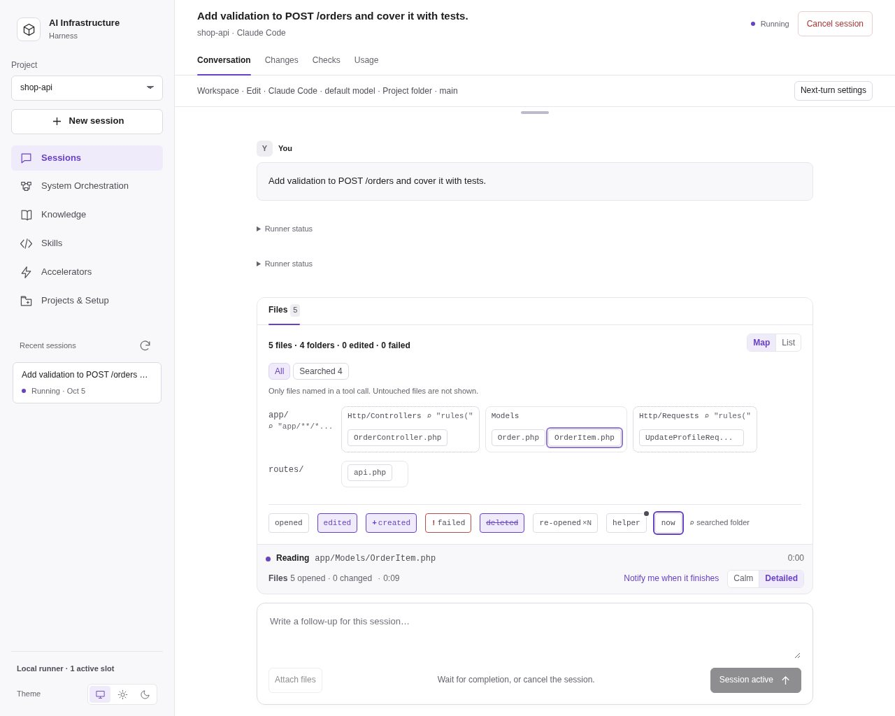
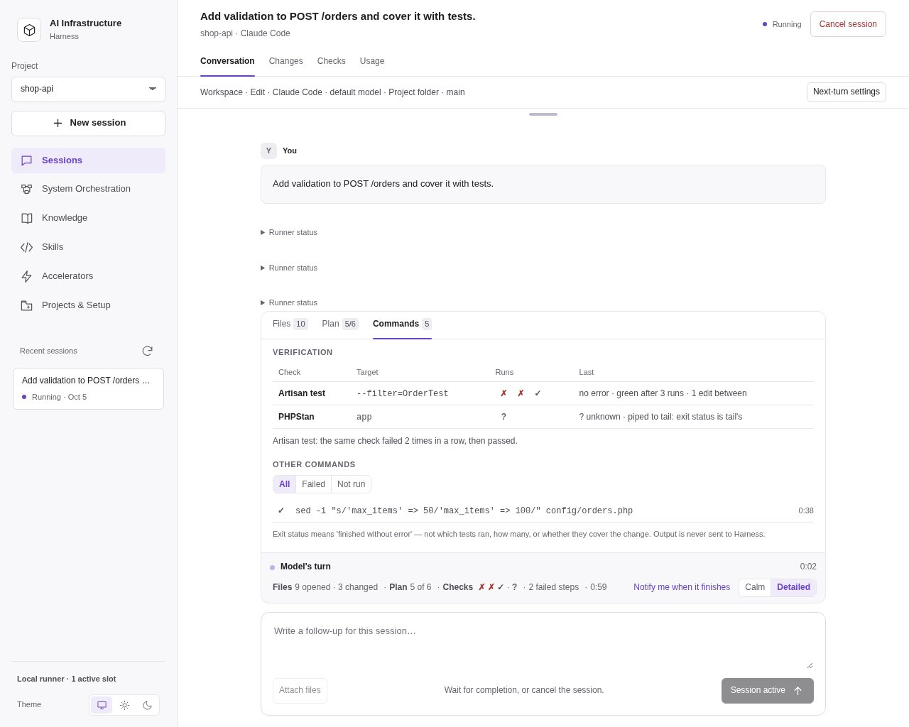
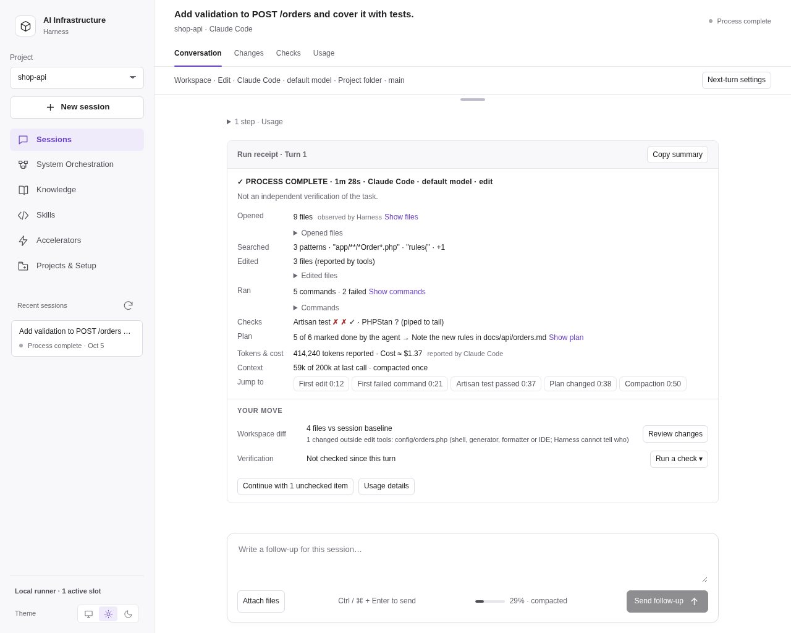

# AI-Infrastructure Harness

> Rust migration, 2026-11-03: Python test and demo invocations below are
> retained pre-Rust behavior specifications and historical evidence. They are
> not verification commands for the migrated checkout. Run the registered native
> suites from the repository root with
> `cargo test --manifest-path runtime-rust/Cargo.toml --workspace --all-targets --locked --offline`.
> Current coverage is defined by those Rust assertions; historical passes are
> not transferred to the port.

A local browser workspace over **Claude Code, Codex and Cursor Agent**.
Kit 1, Kit 2 and Kit 3 are sections within the workspace.
The native Rust batch runner is described below.

In **Sessions**, use **Attach files**, select files and write your message. You
can remove files before sending. Each message accepts up to five files, 4 MiB
per file and 8 MiB total. Sent files appear as downloads in message history and
survive server restarts. Unsent selections remain in the current page only.
Uploads are stored under the Harness state directory, outside the selected
project/worktree. Native agents receive local paths and read them using their
available tools; document/image format support depends on the provider and tools.
Filenames and sizes are validated, and stored bytes are checked before use.
Attachments are reference data and are not automatically executed or promoted
into Memory Bank. A failed send retains the selected files for correction.

## Merge chats into a new task

In **Sessions**, choose **Merge** next to **Recent sessions** in the sidebar.
Select 2–8 finished chats of the project chosen in the sidebar, choose
**Continue with selected chats**, then select Codex, Claude or Cursor, adjust
the new task's message and settings, and choose **Merge into new task**.
Sources may use different providers. The new task starts a fresh native session
in the project folder. The original chats stay unchanged and open from the
links above the composer; **Cancel merge** returns to an ordinary new session.

The new task preserves an immutable, attributed copy of each source's visible
user and assistant messages, including decisions and progress written there.
**View saved context** shows those messages by source. A bounded preview and the
full local archive path are passed on the first launch; the agent must read
omitted context and reconcile conflicting decisions against the current code.
Conflicts remain explicitly unevaluated until then. Nested merges retain their
inherited sources. Later source messages do not change the saved snapshot.

This covers conversations captured by Harness, not external client chat lists
or a full native transcript export. Tool output, hidden reasoning, attached
file contents, memory notices and memory-draft blocks are not copied. Native
file-read permissions still apply; an agent that cannot read the full archive
must report the limitation. Claude receives access to the individual archive
directory. This is not a read-only filesystem boundary in Edit mode: changing
that file makes the next first-launch integrity check fail, while the database
snapshot remains available in the UI. **Restart merged task** rewrites a
missing or changed archive file from that snapshot before it runs again.

Otherwise a merged task is an ordinary new session: project memory works as it
does for any new session, and helpers, models and budgets are chosen as usual.
It always runs the native workflow in the project folder, without attachments
or Clash. A Claude task starts with a written instruction, not a Claude Code
command, which would reach the CLI without the merged context. The launch sets
`CONTEXT_CONTINUITY_RESTORE_DISABLED=1`, so a native merge prepared with
`context-load merge` for that client is not consumed by this Harness task; the
project's hooks keep capturing its chat.

Automatic project memory names the merged chats. An instruction you write
leads the Brain task goal, its task ID and the first turn's memory query, as
for any new session; the chats' titles follow it, and the query carries each
chat's first request. The prefilled instruction names no subject, so memory
leaves it out, and when it is all there is the goal starts with the titles
instead. The goal is one line of at most 200 characters, so long titles after
a long instruction are cut there; the query keeps them. A merged chat is named
by the chats it merged, even after its saved context was deleted. The first
message stays as written.

Running chats and Creator, Fleet, Clash, System Orchestration or AI discovery
runs are not listed and cannot be selected. A source is limited to 512 KiB of
visible messages and 10,000 events; an archive to 2 MiB. Saved archives of all
projects in one state directory are limited to 128 and 64 MiB of serialized
history; a nested merge stores its inherited archives again. Exceeding a limit
rejects the new merge without truncating or deleting saved context. To free
storage, open a finished merged task you no longer need to restart and choose
**Delete saved context**, then confirm. That removes its saved copy of the
chats; the task, its conversation, its source list and the original chats stay,
but the agent can no longer read the copy and the task cannot restart from it.
The storage is freed at once, because the limits count the database copies.
The archive folder goes too, unless something else was written into it (a
Claude agent in Edit mode can write there): the Harness never removes unknown
files, so it leaves that folder in place, names it in the conversation, and a
later start removes it only once it holds nothing else.
Archives live privately in the Harness state directory and SQLite,
outside project Git. Retries with the same request identity create at most one
task. A merged task that stopped before its provider created a native session
(after a server restart, a full queue or a failed start) offers **Restart merged
task**. This explicitly reruns its first message; inspect any partial work
first. Automatic duplicate-request retries only requeue targets that never
started a launch. Once a native session exists, use ordinary follow-ups.
Startup removes orphan archives left by a crash before the database commit.

## System orchestration in the browser

**System Orchestration** coordinates development changes across registered
service repositories. It has two tabs and works on the project chosen in the
sidebar: **Services** holds the system file, its contract map and the editor;
**Changes** holds plans, launches, agents and receipts. On **Services**, choose
**Choose system folder…** to open another folder as the system project (it is
added to your projects and becomes the working project in every view), then
**Create or edit system**.
Use **Add service folder** to browse existing folders; selected folders are
registered automatically. Select **Codex, Claude Code or Cursor Agent**, then
**Fill with AI** to discover the system name, service IDs, owners, responsibilities,
capabilities, contracts, dependencies and context sources from a bounded evidence
snapshot. The ordinary forms are populated automatically, with cited files and
uncertainties available for review. Unknown owners stay `unknown`; complete
dependency coverage stays unconfirmed. Review or adjust the result, then
**Save system**. The application writes `system.json` and service passports,
no JSON editing is required, and the editor gives way to the updated map.
Existing systems open in the same form.
AI scanning uses the single Harness queue, supports cancellation and restores
its original draft after interruption/reload. It requires bubblewrap on Linux or
`sandbox-exec` on macOS, plus an installed/authenticated native CLI. The agent
reads copied evidence; original service folders and unrelated projects are absent
from its filesystem. OS/CLI runtime and that provider's native account state remain
available for login and normal CLI operation. This is not isolation from the
provider's own account/history data. Secret patterns, links, binaries, dependency
trees and ineligible memory chunks are excluded. Limits are 50 services, 120 files
and 1 MiB per root, 64 KiB per file, 8 MiB total; omissions are reported. Sources
are checked again before accepting results and at both save stages. Manual
editing remains available when a CLI or isolation backend is unavailable.
A failed scan names its cause (for example an expired CLI login with the command
to sign in again, or a host that blocks bubblewrap's user namespaces), and the
editor warns before scanning when the sandbox cannot start on this host. See
[Troubleshooting AI discovery](../docs/AI-SYSTEM-ORCHESTRATION.md#troubleshooting-ai-discovery).
Alternatively, **Load system** reads an existing relative system file
(`system.json` by default). Inspect the interactive cross-service `SystemGraph`
(contract kinds, `declared`/`verified`/`undeclared_in_code` provenance, version
mismatch risks, cross-service cycles, shortest paths, shared providers/consumers,
service tiers, and drill-down into any member service's Graphify code graph).
Selecting a link between two services also opens **Code on both sides**, including
a collapsible **Semantic framework & DB bridges** section (`semantic_bridges`)
showing discovered cross-service HTTP/RPC `routes`, `events` between producers
and consumers, `di_bindings`, and shared database `tables` (`shared_read`,
`cross_read_write`, `shared_write`) with clickable file jumps onto each service's
code map.
A file chosen there, from what the search of the system map finds or with **Map**
beside a file of a receipt, is selected in the code map of its service that is
embedded in the view: the folders that hold it open in that picture, the picture
is brought to it, and what the change does to it is listed beside. No window
opens over the view; **Full map** of the embedded picture still opens one. Then
review capabilities and memory ownership, and **Plan a change** (or **New change** on
the **Changes** tab): describe the task, choose starting services or changed
contracts with live blast-radius preview, and prepare a bounded context/impact
plan. Review its sources before execution. The backend checks freshness again
when queued work actually starts.

A change moves through **Plan**, **Review**, **Run** and **Receipts**. In the
**Launch** card of the reviewed plan, choose **Codex, Claude Code or Cursor
Agent**. Each uses
its configured CLI and default model. The provider is fixed after launch,
including recovery. Browser requests cannot supply executables. Workers run
sequentially through the same single Harness queue;
read-only is the default. Native system/service Brain task records are written
even in read-only mode. Edit mode uses each service's current checkout.
Every agent of a run shares one context: it reads the system folder and every
selected service, and receives the task, the plan's excerpts, the reviewed
memory of the system and of every selected service, and the complete reports of
the agents before it (shortened only when they would not fit its prompt). Each
agent's exact input is saved next to its receipt. A completed run's outcome
becomes the system's memory by itself, and later changes share it with every
agent, marked as memory no person reviewed.
**Service agents may edit** decides only where service agents write:
**All selected services** (the browser default) lets each service agent change
files in any of them in edit mode; **Own service only** keeps its edits in its
own folder. The system folder stays read-only. Claude receives the folders it
writes through `--add-dir` and the others through read rules (plan mode adds
them all), Codex reads the whole disk and is granted only writable roots;
Cursor Agent supports only own-service edits.

In the **Launch** and **Recovery** cards, **Permissions** selects how edit
dispatches handle host tool and file approvals: **Auto** (default), **Manual**,
or **Bypass Permissions** (read-only dispatches always remain read-only
regardless of the setting):

- **Manual** routes every provider permission ask and native question through
  Harness's permission desk (`SystemWorkflow` -> `PermissionDesk`) and surfaces
  pending requests inline as `waiting_permissions` cards in System
  Orchestration, resolved against the run's backing session
  (`POST /api/sessions/{session_id}/permissions/{request_id}`).
- **Auto** grants intra-service edits according to each provider's auto mode
  while **escalating cross-service and contract-ownership boundary asks** to
  human confirmation (`SystemBoundaryApprovals` marks escalated asks `Auto ->
  Manual boundary escalation`, strips **Allow for this session**, and waits via
  `waiting_permissions`); non-interactive `Transport::Text` edit dispatches
  (such as Codex `Auto` and Cursor `Auto`) enforce write boundaries after the
  step via post-step checks (`check_step_boundary_writes_with_extra`).
- **Bypass Permissions** disables host approval prompts and sandboxes
  (`bypassPermissions` / `--dangerously-bypass-approvals-and-sandbox` /
  `--force --sandbox disabled`) within the selected dispatch folders; like all
  non-interactive `Transport::Text` edit dispatches (`Auto` and `Bypass`), it
  still enforces post-step boundary write checks (`__system__`, out-of-root, and
  foreign-service/contract boundaries according to the selected `access` scope).

The **Agents** panel follows a launched run live: one card per agent (contract,
each service, verification) with state, time, granted folders, tool calls,
tokens and changed files, structured `Timeline | Files | Plan | Commands` views
backed by durable `<phase>-a<attempt>.evidence.json` dispatch artifacts (including
`sed -n` shell-read attribution, Graphify query usage when **Tell agents about
service code graphs** is enabled, and cross-service unopened consumer reach), and
a live system/service graph lens following active dispatches. Paths appear as
`service · path`. It stores no file contents, diffs, command output or prompts,
redacts detected secrets and is bounded per agent and launch; receipts stay
authoritative. During **Fill with AI** the same panel follows the discovery agent
and maps copied evidence back to original service paths.

Saved changes show dispatch state, worker-reported checks, scoped changed files,
the knowledge handoff and, behind a toggle, native task references and the
runner log. Cancel stops provider trees;
recovery requires an explicit resume and an explicit dispatch retry after an
ambiguous interruption. Inspect partial edits before accepting changed sources.
Completed dispatches are skipped, and server restart never automatically resumes
work. The folder picker registers external service roots; existing manifests
can also use project folders chosen in **Sessions**. The manifest
cannot grant host filesystem access. See the [system orchestration guide](../docs/AI-SYSTEM-ORCHESTRATION.md#harness-ui).

## Infrastructure Creator in the browser

Choose **Infrastructure Creator** (also available through Kit 1), a registered
PHP project, Claude/Codex/Cursor, model, thinking effort, **Permissions**
(**Auto** default, **Manual**, or **Bypass Permissions**) and additional-agent
limit. The permission setting persists with the run across **Start**, **Revise**,
**Generate** and **Rescan** (`waiting_permissions` appears inline on the
Creator view and is answered against the run's backing session). Choose the current project or a new Git worktree, select the integrations
to generate, and start a scan. A worktree starts from committed HEAD; uncommitted
files are not copied. Targets must be outside the Harness source/state trees.

The server copies the existing generator into a private task workspace and runs
its native workflow in the shared session queue. Filesystem isolation is
required: **bubblewrap** (`bwrap`) on Linux, or the built-in **sandbox-exec**
(Seatbelt) on macOS, or native **Codex elevated sandbox** with permission-profile support on Windows. Agent writes are confined to the workspace, a private
temporary directory and native provider account-state directories; the project
and Creator control files stay read-only (bind mounts on Linux, write denial on
macOS, elevated capability/ACL policy on Windows). Native authentication remains with each provider. Network
access and native integrations remain available; this is filesystem isolation,
not a general-purpose sandbox for hostile plugins. Apple marks `sandbox-exec`
as deprecated but still ships it; a provider CLI that must write outside its
account directory fails inside the profile and reports it. Creator model-phase budgets can
be changed in the browser; empty time means no time limit. Apply and rollback
do not inherit model budgets.

Read the scan profile, generation plan and quality report, answer any questions,
and choose **Approve profile & generate**. Canonical generator validators run
independently after the provider exits. Generation ends at staging. Inspect the
file diffs and approve each replacement of existing team edits before choosing
**Apply reviewed files**. A changed project, staging payload or reviewed report
invalidates the approval. To preserve or merge a file differently, request a
revision; the generator prepares a new candidate and ownership manifest.

**Update existing accelerator** requires `.infra-manifest.json`. Runtime memory
and Project Brain records cannot be overwritten by the publication plan. Apply
uses the existing manifest-last publisher, then validates the installed target
with a disposable SQLite cache. On Linux that cache is a temporary overlay and
verification does not change the project cache; on macOS the project's ignored
`memory-bank/local` cache is rebuilt in place, because Seatbelt cannot overlay
a directory.
A failed postcheck rolls back; an interrupted publication exposes **Recover
interrupted publication**. Recovery preserves external edits made since apply
and reports conflicts instead of silently replacing them. Runs, reports and
recovery journals survive restarts in the server's private `creator/` directory.
Apply/recovery cannot be cancelled from either the Creator UI or session API.

Automated coverage uses disposable native CLI fixtures, real bubblewrap mounts
on Linux, an offline check of the generated Seatbelt profile and the canonical
publication/rollback helpers; model-generated content still
requires the scan and diff reviews and independent verification gates.

## Browser server

### Spec-Driven Development

In **Sessions → Workflow → SDD**, enter a feature slug such as `user-login` and
choose **Initialize**, **Specify**, **Plan**, **Tasks**, **Implement / resume** or
**Review**. Describe the request and launch the selected phase with Claude,
Codex or Cursor. The feature stays fixed; the phase can change on follow-up turns
in the same native session and workspace, including a Git worktree.

New documents live in `specs/<feature>/sdd-{spec,plan,tasks,progress}.md`; shared principles
live in `specs/memory/sdd-constitution.md`. The `sdd-` prefix satisfies installed
accelerator naming hooks. Existing unprefixed documents remain readable in place.
**Read SDD documents** shows bounded,
read-only snapshots from the session's actual workspace. Refresh after edits.
Review documents before explicitly selecting and sending the next phase.
Initialize only requests missing guidance; existing project documents are preserved.

The server requires nonempty, readable prerequisite documents (maximum 256 KiB
each) and blocks later phases while the specification contains
`[NEEDS CLARIFICATION` markers. It checks again before a provider starts, including
inside a new worktree. File presence is not semantic approval: native-agent
instructions limit each turn to its selected phase, and humans review its output.
Writing phases use Edit permissions; Review uses Plan permissions. Implementation
instructions require test-first tasks and stopping at the next checkpoint.
Use Results for diffs and independent verification commands. Phase settings are
saved in launch history alongside model, effort and budgets. No separate plugin
installation or automatic phase chaining is required.

### Clash: Claude and Codex confront each other

In **Sessions**, tick **Clash with a challenger** on a Workspace or Review
session. The selected provider is the first participant and a *different*
provider is the **challenger**. The stage follows the session mode:

- **Edit mode (implementation clash):** the first participant implements the
  task with Edit permissions. The challenger then reads the workspace and the
  diff against the session baseline in Plan permissions and returns a verdict
  with numbered objections (severity, file, line, claim, evidence). The
  implementer must fix, rebut or defer every open objection; the challenger
  re-checks and either accepts or maintains its objections.
- **Plan mode (review clash):** the first participant reviews the scope and
  reports findings; the challenger reviews the same scope independently, agrees
  with, disputes or cannot verify each finding, and adds what was missed; the
  reviewer defends or withdraws disputed findings and assesses the challenger's
  additions. The Review workflow always runs this stage.

Each cycle runs the opening turn plus up to the selected number of **challenge
rounds** (1–3, default 2). The challenger's final verdict ends the cycle; the
first participant responds only between rounds. The outcome is **converged**
when the challenger accepts with no blocking items, **unresolved** when the
rounds run out, and **incomplete** when a turn fails or returns no structured
verdict. Structured verdicts are parsed from the fenced JSON block each
participant is asked to end with; the ledger records every objection or finding
with its status and the exchange behind it. The ledger, per-turn usage and a
Markdown report are saved with the session and shown under **Clash ledger**;
Results shows the resulting diff for independent checks and delivery.

Every turn is a separate native run of one participant in the session's
workspace, resuming that participant's own native session. A follow-up message
with the box still ticked starts the next cycle: both native sessions resume,
the session mode stays fixed, and the challenger, the rounds or the challenger's
model and thinking effort can change. Untick the box to send an ordinary
follow-up; tick it later to have the challenger inspect the accumulated work,
continuing the earlier ledger when the stage is the same. The option is not
available for Plan, SDD or Fleet sessions, requires additional agents to be
off, and cannot be combined with separate planning and editing models.
Budgets apply to the whole cycle: Claude turns receive the remaining
USD allowance as a native cap (persisting per-participant `cost_totals` in
SQLite across turns and follow-up cycles so resumed sessions never
double-count), the token threshold counts every turn's reported usage, and the
time limit terminates the cycle (marking the cycle `incomplete` on exhaustion). Cancel stops the running
participant; the ledger recorded up to the previous turn stays visible. The
ledger reports what each participant claimed and which claims survived; it is
not an independent verification of the work.

### Optional models for planning and editing

In Sessions, expand **Separate models for planning and editing** and enable
**Use separate planning and editing models**. Choose a model and thinking effort
for each role from the selected provider, or enter a custom model ID. The common
model controls display the effective selection while this option is enabled.

In SDD, **Implement / resume** uses Editing; Initialize, Specify, Plan, Tasks
and Review use Planning. Writing specification documents does not select the
code-editing model. In Workspace, **Mode → Plan/Edit** selects the role and can
change between turns while the option is enabled. Plan and Review workflows
always use Planning. Fleet and Creator retain their existing model controls.

Both role configurations are validated before launch. Changes apply when sending
the next turn and persist with the session; each launch retains its effective
model, effort and routing settings. Disable the option to use the common model
controls again. The default remains one model, and new sessions start with the
option disabled. Switching stays within one native provider and preserves the
session/workspace; it does not transfer conversations between providers.

### Permissions: Auto, Manual, Bypass Permissions

In **Sessions**, **Infrastructure Creator** and **System Orchestration**, **Permissions** selects what an editing turn may do
without asking. Planning (Plan mode and the Plan, Review and Fleet workflows,
and read-only System Orchestration dispatches)
stays read-only whatever the setting, so nothing in it asks. The setting is kept
with the session or run and can change between turns in **Next-turn settings** (or on Creator **Revise** / **Generate** / **Rescan** and System **Recovery**). In System Orchestration **Auto**, cross-service and contract-source boundary asks escalate automatically to **Manual** confirmation.

| Setting | Claude Code | Codex | Cursor |
| --- | --- | --- | --- |
| **Auto** (default) | `--permission-mode auto`: Claude Code's classifier reviews each action. Where a model has no auto mode (Haiku, for one), Claude Code starts in its default mode; the Harness switches it to `acceptEdits` and says so in the chat | `--approve-for-me`: the workspace-write sandbox, with Codex's automatic reviewer answering what needs approval | Print mode with `--sandbox enabled`: workspace edits and sandboxed commands run |
| **Manual** | `--permission-mode default` with `--permission-prompt-tool stdio`: Claude Code asks before edits and commands | `codex app-server`, a read-only thread with `approvalPolicy: on-request` and the person as reviewer: Codex asks before each edit and each command that writes | `cursor-agent acp`: Cursor asks before actions outside its allowlist (`permissions.allow` in `~/.cursor/cli-config.json`) |
| **Bypass Permissions** | `--permission-mode bypassPermissions` | `--dangerously-bypass-approvals-and-sandbox` | `--force --sandbox disabled` |

In Auto nothing waits for a person: a request the host's own review would put to
a person is declined, and the chat shows it as *declined automatically*. In
Manual each request appears in the chat with its semantic category (`ask_kind`:
`command`, `file_change`, `permissions`, `question`, or `tool`), summary,
optional collapsible unified `diff_preview` (bounded to 6,144 characters for
file edits and writes), optional `rule_summary`, and **Allow**, **Allow for this
session** and **Deny**; the run waits for the answer, and the waiting does not
count against the session's time budget. Allow for this session keeps the
approval within the running session:

- **Claude Code:** suggested permission rules are scoped to `session`, never
  written to the project's settings.
- **Codex:** sends `acceptForSession` for the Codex thread.
- **Cursor:** Cursor's native `allow_always` writes to `~/.cursor/cli-config.json`
  and outlives the session, so Harness never sends `allow_always` to Cursor CLI.
  Instead, for clean workspace-relative `edit`/`read`/`delete` paths and exact
  chain-free shell commands (no `;`, `|`, `&`, `` ` ``, `$`, `>`, `<` or
  newlines), Harness builds a canonical local `session_rule_key`
  (`session_option: true`, `has_session_rule: true`). Choosing **Allow for this
  session** caches that key only in the Harness server's in-memory per-session
  allowlist (bounded per session) and replies `allow_once` to Cursor CLI;
  repeated matching asks in the same Harness session auto-resolve immediately as
  `allowed_session` (`by: "session_rule"`) with `allow_once` without prompting
  again or touching `~/.cursor/cli-config.json`. Chained commands, paths outside
  the workspace and other tools keep `session_option: false` and offer Allow
  and Deny only.

In Manual mode, native structured questions — Claude Code's `AskUserQuestion`,
Codex's `item/tool/requestUserInput` and Cursor's `cursor/ask_question` — also
surface as `ask_kind: "question"` cards (`session_option: false`) with
single-select or multi-select options and optional `"Other"` freeform inputs,
and **Submit answers** / **Decline** buttons. Auto mode declines native
questions automatically.

Setting `HARNESS_PERMISSION_TIMEOUT_SECONDS` to a positive integer configures a
per-ask TTL on pending Manual waiters (disabled by default when unset or
non-positive). If an ask remains unanswered after that TTL, Harness removes the
waiter, emits an `expired` event (`by: "timeout"`) and sends `Deny` to the host
so the CLI does not hang indefinitely. A request the host withdraws, or one
still open when the run ends or is cancelled, is answered no and marked as no
longer waiting. Bypass Permissions runs every action without asking and without
the sandbox: use it only in a disposable checkout or container.

Manual keeps the host's input open instead of closing it after the prompt:
Claude Code reads stream-json, and Codex and Cursor run their protocol servers,
which the Harness stops after the turn when they keep serving. Their events are
read exactly as in a one-shot launch. Cursor's ACP mode has known gaps of its
own (plugins may not load), so an attached project's Cursor policy arrives as
the prompt preamble. The Harness runs `cursor-agent` rather than `agent`, a name
other tools install too; the ACP server needs a CLI signed in with
`cursor-agent login`. Cursor reports a command the person denied as completed;
the Harness records it as not run, not as a success. Cursor CLI 2026.11 also
keeps a model a launch names with `--model` as its default for later launches,
in the Harness or not. A session created through the API without `permissions`
keeps the behaviour from before the setting: workspace edits only, everything
else declined.

| Request | Response |
| --- | --- |
| `POST /api/sessions` or `POST /api/sessions/{session_id}/messages` with `"permissions": "auto"`, `"manual"` or `"bypass"` | The session with its `permissions`; any other value is refused with `400` |
| `POST /api/sessions/{session_id}/permissions/{request_id}` with `{"decision":"allow"\|"allow_session"\|"deny", "answers"?: <object\|null>}` | `200`, `{permission, session}`; `409` when the request no longer waits; `400` for `allow_session` on a request that cannot be remembered or non-object / >32 KiB `answers` |

A request is the session event `{"kind":"permission","state":"pending","request_id",…}`
with `provider`, `tool`, `summary`, `detail`, `session_option`, `ask_kind`,
`diff_preview`, `rule_summary`, `has_session_rule` and `questions`; later events
of the same `request_id` carry `allowed`, `allowed_session`, `denied`,
`declined`, `withdrawn` or `expired` (with `by` naming `"person"`, `"auto"`,
`"session_rule"`, `"host"`, `"harness"` or `"timeout"`, plus `answers` when
structured question answers were submitted). Codex and Cursor number their
requests afresh in every process, so `request_id` is the host's id followed by a
tag of the run (`cursor-0-1c029d06`): each turn's requests stay apart.

### SkillCache: a repeated skill as a compiled plan

SkillCache turns a repeated use of a skill from "the model reads `SKILL.md` and
works out the steps again" into a short plan whose deterministic parts are
programs a local executor runs. It is **off by default** and every part of it is
opt-in per session. Nothing here claims a saving: what a capsule costs to compile
and what it saves per reuse is something to measure, not a promise.

A session opts in with `skillcache` when it is created, and a follow-up may
change it for the next turn:

```json
{"skillcache": {"mode": "observe"}}
```

| Mode | What a turn does |
| --- | --- |
| `off` (default) | Nothing of SkillCache runs. |
| `observe` | The turn runs as usual with the unchanged skill, and its observed trace is kept. |
| `auto` | A qualified capsule is used when one matches; otherwise the turn is cold and its trace is kept. |
| `warm_only` | A matching capsule is used; nothing is recorded. |

SkillCache applies to ordinary sessions. Fleet, Clash, SDD, the Plan and Review
workflows, System Orchestration and Infrastructure Creator refuse the option.

**Keeping a trace is a deliberate change to what the Harness stores.** Without
this option the Harness never stores a tool's output: the activity view keeps a
bounded description of each call and nothing of what came back. In `observe` and
`auto` a completed cold turn's trace is stored: each tool call with its
arguments, paired with its result, and the agent's messages. So choose the mode
per session, for work whose tool output you are content to keep on this machine.

What a kept trace is:

- **Without reasoning.** Provider reasoning (Claude `thinking` and
  `redacted_thinking`, Codex `reasoning`, Cursor `thinking`) is dropped unread
  and only counted.
- **Redacted.** The values of the launch's credential-like environment
  variables, command-line credentials, and whatever the shared secret policy
  names are replaced before anything is stored; paths of this machine become
  workspace-relative (`~/...` for the home folder). The row records how many
  places were changed.
- **Bounded.** One result is at most 64 KiB and one call's arguments 16 KiB,
  with a marker where something was cut; the whole trace is at most 8 MiB, after
  which results are left out and counted.
- **Only of a turn worth compiling.** A turn that failed, ran no tool, or used no
  skill of the project or of your home folder leaves nothing behind; the session
  says why in one line.
- **Private.** Traces are rows of `skillcache_traces` in the Harness's own
  `sessions.sqlite3`, under the private state folder, never in the project, its
  `memory-bank/` or its `project-brain/`. A session keeps its ten newest traces
  and a trace is dropped after thirty days.

Each skill the turn used is recorded with the digest of every file of its
folder, so a later compile can tell that the skill has changed since. An
observed turn also records the state its workspace started from: for a Git
checkout, a tree written through a private index into a private object folder
under the Harness state (the project's own repository is read and never
written); for a non-Git folder, a bounded directory copy (`kind: "tree"`,
skipping every `.git`, the `target` and `.harness-tmp` of the folder's own
root, the Harness state folder and special files, up to 50,000 files /
256 MiB / depth 32). A checkout that Git cannot read (no Git on `PATH`, an
ownership refusal, a timeout) keeps no snapshot: it is not copied as a folder.
In both kinds a symbolic link is kept when it is relative and stays inside the
tree, which is what installed dependencies are made of; a link that leaves the
tree is not copied. A Git snapshot holds a file as Git would commit it and
writes it back as Git would check it out, so line endings follow the
checkout's Git settings: with `core.autocrlf` on (the default of Git for
Windows), a file a tool wrote with line feeds comes back with CRLF.
`GET /api/sessions/{session_id}/skillcache` lists a session's mode, its kept
traces without their steps, and what was compiled from them.

#### Compiling a trace into a capsule

Compilation is an explicit action on one observed turn; nothing compiles on its
own:

```text
POST /api/sessions/{session_id}/skillcache/compile
{"generation": "<the observed turn>", "compiler": {"provider": "claude", "model": null}}
```

There is no "compile this skill" request: without an observed turn there is no
trace to compile from. The request answers `202` and the work runs in its own
queue, one compilation at a time, outside the session queue.

The **compiler** is a Claude Code launch in the same operating-system sandbox as
AI discovery, started read-only with the shell, every editing tool, the network
tools and the skill loader switched off. It is given the request, a compact view
of the redacted trace, a copy of the skill's files and its instructions; the
project, its Git folder and the observed values of other capsules are not in its
sandbox, and the same sandbox is checked for that before the compiler starts. It
returns one structured answer and the Harness writes every file. Claude is the
only compiler in this version because it is the only CLI that can be started
with no shell at all; the session being compiled may be any provider's.

Three **gates** then check the candidate, none of them with a model:

| Gate | Where | Passes when |
| --- | --- | --- |
| 1 | in the Harness | the capsule's structure and dataflow hold: every program runs in exactly one step, every input is a binding, an earlier output or a value an earlier instruction produces, outputs are only what later programs read, verification programs are read-only, commands name package files and declared runtimes, and no observed value, file content or secret is in it |
| 2 | a fresh sandbox, no network, no task file | every program's own `check` answers by the program contract |
| 3 | a fresh copy of the task, the network only if the capsule declares it | the plan replays through `skillcache-run` with the observed values answering for the agent, and reproduces the observed workspace file changes |

Gate 3's copy comes from the turn's starting snapshot: for a Git checkout, the
saved tree plus the workspace's Git-ignored files (installed dependencies, build
output) as they are at that moment, up to 1 GiB and 100,000 files; for a
non-Git folder, the bounded directory snapshot. The replay never touches the
real workspace. A failed program does not end the replay: its observed output
stands in and the replay goes on, so one pass reports every failure; a program
declared read-only that changes the copy fails too.

The Harness records which regular files the cold turn added, edited or removed.
Gate 3 compares that delta with the replay's delta. Both the changed paths and
the final bytes must match. A missing, different or unexpected change fails
with `replay_result_mismatch`. The observation keeps only SHA-256 fingerprints
beside the snapshot, and the gate reports counts. A successful replay with
no file changes on either side reports `no_file_changes`. The comparison
covers regular files inside the workspace, excluding `.git`, the Harness
state directory, and the root's `target` and `.harness-tmp` folders.
Each capture is bounded to 50,000 entries, 256 MiB, 32 levels and 60 seconds.
Git-ignored outputs can already be present in the replay's starting copy.
If an output is already present with the observed bytes, rewriting it leaves
no delta for Gate 3 to match.
If the evidence is missing, including for observations from older versions,
observe the turn again to qualify or requalify a hybrid capsule.

The gates run in a minimal root: the operating system's runtime, the package
and the task copy. That is deliberately stricter than a session, so a program
that needs a tool installed under your home folder is refused here with
`sandbox_denied` rather than failing later. Compilation and Gates 2 and 3 need
bubblewrap on Linux, `sandbox-exec` on macOS and an elevated Codex sandbox on
Windows; without one nothing is qualified. There is no unconfined fallback.

A refused candidate goes back to the compiler with every violation of that
round, for up to three hybrid attempts. Then the compiler is asked for the
**textual form**: a shorter written procedure that the agent reads instead of
the skill, checked for shape, size, secrets and observed values (Gates 2 and 3
do not apply: nothing of it is executed). If that is refused as well, nothing
is compiled and the skill is used as it is.

A compilation is not a turn of the session. It never appears in the session's
launch history; its rounds, outcome and whatever usage the provider reported are
kept in `skillcache_compiles` and shown with the capsule. A field no round
reported stays empty; it is not shown as zero.

#### Capsules

| Request | What it does |
| --- | --- |
| `GET /api/projects/{project_id}/skillcache/capsules?skill=&status=&form=&include_retired=&include_eval=` | lists a project's capsules (retired capsules are excluded unless `status=retired` or `include_retired=true`; the capsules of an evaluation arm are listed only with `include_eval=true`, which is how they are found to be deleted) |
| `GET /api/projects/{project_id}/skillcache/capsules/{capsule_id}` | the plan (`mu`, bindings, programs, steps, verification), every gate report of every round, the compilation and its usage; never the programs' sources or the observed values |
| `POST .../capsules/{capsule_id}/requalify` | runs the gates again over the stored package: no model, the same observed values, a fresh copy of the task (also restores a `retired` capsule to `active` if gates pass) |
| `POST .../capsules/{capsule_id}/retire` | retires a capsule (`retired`) so warm turns skip it until someone uses **Use again** (`requalify`) |
| `POST .../capsules/{capsule_id}/invalidate` | marks an `active` or `needs_recompile` capsule `stale` until it is requalified |
| `DELETE .../capsules/{capsule_id}` | removes the capsule, its package, its observed values, and the trace and snapshot it was compiled from |

A capsule is `active` only while it still matches what it was qualified with.
It becomes `stale` when any file of its skill's folder changes (not only
`SKILL.md`: scripts, references and assets count), when the SkillCache ABI or
capsule schema changes, when a declared runtime its programs use changes, when
the compiler's instructions change, or when its package is no longer what was
written. Rebuilding `infra-engine` without changing the SkillCache ABI, schema,
compiler rules, or runtimes keeps existing capsules active (`engine_digest` is
recorded only as metadata). A capsule whose skill changed is not requalified:
it describes the old skill, so a new turn has to be observed and compiled.

Artifacts live under the Harness state: `skillcache/capsules/<project>/<capsule>/1/warm/`
is the read-only package a session would mount, without any observed value, and
`skillcache/qualification/<capsule>/1/examples.json` holds the observed values
for Gate 3 alone. Capsule progress is published as `skillcache_capsule` events
on the project's event stream.

#### Warm turns

In `auto` and `warm_only` a turn runs a capsule only when all of this holds;
anything else is a **miss**, the turn runs exactly as it would without
SkillCache (the same prompt, byte for byte), and the session says why in one
line:

| Condition | Miss reason |
| --- | --- |
| the message routes to exactly one skill | `no_single_skill` |
| the session is in Edit mode (a capsule's programs write) | `plan_mode` |
| the provider is Claude or Codex | `provider` |
| the message is not a native Claude Code command, which goes to the CLI as typed | `native_route` |
| Codex is not in Manual mode, where it would ask before every step of the executor | `codex_manual` |
| the skill has exactly one active capsule | `no_capsule`, `ambiguous` |
| the capsule still matches its skill, environment, rules and package | `stale` |
| the capsule needs no network, or Codex runs in Bypass | `network` |

In this version a message routes to one skill for both Claude Code and Codex
through a single `$skill` mention. For Claude Code the mention is routed only
in a session that opted into SkillCache (any mode but `off`): an ordinary
Claude session's message goes as it was typed. A Claude Code `/command` is native (`native_route`),
so `/command` turns are observed and compiled from without running warm, and
Cursor is observed only: writing outside the workspace in its sandbox is not
verified.

On a **hit** the request to load and follow the skill is replaced by the
capsule's block: its name and description, the values to take from the request,
its opening steps and the executor's protocol. The block never contains an
observed value, a program's code or where the package is; the launch's prompt
ledger counts it as its own `skillcache` category. The Harness puts
`skillcache-run` and `skillcache-tool` (the engine under those names) first on
the provider's `PATH`, sets where the capsule, the workspace and the run's state
are, lets Claude Code call the two commands without asking, and gives Codex's
sandbox the one extra writable folder the executor's state file needs. The
package is not added to the agent's readable folders: the executor reads it,
not the model.

The agent then follows the protocol:

- `skillcache-run run '{...}'` starts the plan with the values the request
  states. Consecutive programs run without returning to the agent.
- `needs_bindings` asks for values, `your_steps` hands over the steps that need
  judgment, and both continue with `skillcache-run continue '{...}'`.
- `program_failed` hands over exactly one step: the agent does it with its
  normal tools and the source skill, supplies the outputs later programs read,
  and the rest of the plan stays compiled. A failed program is never started
  again, neither by the executor nor through `skillcache-tool`. Only a plan
  step's program source is offered for reading, never a verification program's.
- `complete` returns the programs' results.

Each phase appears in the conversation as a `skillcache` event (`hit` or `miss`,
then `started`, `program_completed`, `program_failed`, `your_steps`, `complete`),
read from the journal the executor writes beside its state. A warm turn is
recorded in `skillcache_runs` with its outcome and how many steps fell back to
the agent; its tokens and cost are the launch's own. It is never stored as an
observed trace. A step that fell back is a property of that run: the capsule
stays active, and nothing recompiles on its own.

The composer's preflight (`POST /api/projects/{project_id}/preflight`) answers
with a `skillcache` field when it is given the composer's SkillCache mode: what
the turn would do, the capsule it would run or the reason it would run cold.
Making the preview stages nothing and changes no capsule.

When a skill has several active capsules, choosing among them by their
descriptions is an experiment behind the Harness setting
`skillcache.retrieval_by_mu`, off until it has its own measurement; without it
such a turn is a miss.

The pieces a capsule is made of can be tried by hand: `infra-engine skillcache
--help` describes the plan executor (`skillcache-run`), the program tool
(`skillcache-tool`) and the structural gate.

#### In the page

- **Composer.** The `SkillCache` chip says the mode of the next turn; it is
  `Off` until someone chooses otherwise. Its panel has the mode, an optional
  compiler model, and a sentence that says what the chosen mode keeps and what
  it runs for the selected provider. The choice is remembered with the draft
  like the other options, and a selected session shows its own stored option.
  The option is unavailable in Fleet, Clash, SDD, plan and review workflows.
- **Preview of the next turn.** With `Auto` or `Warm only`, a prompt that names
  a skill or a command is previewed beside the risk check: `Warm: <capsule>`,
  `Miss: cold (<reason>)` or `Stale: cold`. A preview stages nothing.
- **Conversation.** A SkillCache card appears for what a person may act on: a
  capsule that was used, a kept trace, values or steps the agent was handed, a
  program step handed back with its reason, the plan's completion, and a miss
  whose cause can be fixed. An ordinary turn of an `Auto` session is a miss
  every time and gets no card.
- **Run view.** A turn with SkillCache events gets a `SkillCache` tab that lists
  every phase in order. A kept trace offers **Compile into a capsule** once;
  after that it shows the compilation's state and links to the capsule. A
  trace whose starting snapshot or workspace result was not kept says what
  evidence is missing in `replay_reason`.
- **Usage.** A session that used SkillCache gets one line above its launch
  history: how many turns ran warm, how many ran cold and why, how many
  compiled steps went back to the agent, how many traces are kept, and what
  the compilations cost. That cost is the compiler's and is in none of the
  launches listed below it; a compilation without a reported price is said to
  be unpriced, not free.
- **Skills → Skill capsules.** The project's capsules with their status and
  form, filterable. One capsule shows what it is for, the values it needs, its
  programs (their commands, never their sources), its plan and verification,
  the skill it was compiled from, its compilation, its gate history round by
  round, and how its warm turns went. **Requalify** (or **Use again** when
  `retired`) runs the gates again without a model, **Stop using** retires it
  (`retired`) until someone uses **Use again**, and **Delete** takes a second
  click. What a reuse saves is shown as unknown: it is measured by a
  [sealed evaluation](../docs/SKILLCACHE-EVAL.md), never read off a session.

#### A capsule's status

| Status | Meaning | Used by a warm turn |
| --- | --- | --- |
| `compiling` | Its compilation is queued or running. | no |
| `active` | It passed its gates and still matches its skill, environment, compiler rules and package. | yes |
| `stale` | Something it was qualified with changed (a file of the skill, a runtime, the SkillCache ABI/schema/rules), or `/invalidate` marked it stale. The reason is shown. Requalify it, or compile a new turn. | no |
| `needs_recompile` | A requalification failed, or the recompile setting below marked it. | no |
| `failed` | No form qualified. The skill is used as it is. | no |
| `retired` | A person clicked **Stop using**. Excluded from warm turns and hidden by default unless `status=retired` or `include_retired=true` (used by **All** in the page). **Use again** requalifies it. | no |

A step that fell back to the agent is a property of that turn. By default the
Harness only shows how a capsule's warm turns went. The setting
`skillcache.recompile_thresholds` lets those turns mark the capsule
`needs_recompile` by themselves: `{"window": N, "failed_runs": K}` marks it
when `K` of its last `N` warm turns handed a program step back. It is absent
by default and the Harness has no thresholds of its own, because none has been
measured; like `skillcache.retrieval_by_mu`, it stays off until a sealed
evaluation of its own says what the numbers should be.

#### Measuring it

Whether a capsule pays is a measurement:

```bash
infra-engine eval skillcache-ab seal --plan plan.json --out protocol.json
infra-engine eval skillcache-ab run --protocol protocol.json --out result.json
infra-engine eval skillcache-ab report --protocol protocol.json --result result.json
infra-engine eval skillcache-ab viewer --protocol protocol.json --result result.json --out benchmark.json
```

[docs/SKILLCACHE-EVAL.md](../docs/SKILLCACHE-EVAL.md) describes the sealed
protocol, the real Harness pilot driver (`infra-harness-skillcache-driver` in
`runtime-rust/crates/infra-harness/tools/skillcache_driver/`, plus the four
eval-only ablation modes `raw_trace`, `written_procedure`, `skillcache_agent`,
and `skillcache_no_replay` unlocked only when store setting
`skillcache.eval_arms` is `true`), the isolated verifiers, and the verdict.
A report is evidence for the question that was sealed; it turns nothing on.

### Starting the server

Supports Linux, macOS and native Windows 10/11 through the platform's native engine and at least one authenticated provider CLI. The server and Fleet runtime are Rust; browser business logic is Rust/Wasm. Install a verified engine and its generated UI assets. A Python virtualenv is not part of the runtime.

On Windows, install Git for Windows and the provider CLI, then run the native `infra-engine.exe` from PowerShell or a terminal. State defaults
to `%LOCALAPPDATA%/ai-infrastructure-harness` (Linux/macOS retain XDG state).
Projects and state must use local drive paths; junctions, symlinks and UNC/network
roots are refused at protected filesystem boundaries. npm-installed Codex and
Claude launch through Node.js directly; arbitrary `.cmd`/`.bat` check scripts
are refused. Use a native executable or Node/Python script for checks.
System Orchestration runs on Windows too. Its AI discovery (**Fill with AI**)
runs in Codex's elevated sandbox, like Creator phases, and needs Codex for that
even when Claude or Cursor scans. Before each scan a probe checks inside the same
sandbox that no original file is readable.

Infrastructure Creator on Windows also needs Codex CLI, even when the selected
provider is Claude or Cursor. Complete elevated sandbox setup in native Codex
(the setup may request UAC). Harness supplies a random per-launch permission
profile; target, Git common directory, source and control state remain read-only.
A native boundary probe runs before each phase; failure stops the phase without
falling back to unelevated execution. Provider state must not overlap protected
project or Harness directories. Installed runtime checks use a disposable copy
so the target SQLite cache is unchanged. Git Bash must provide `bash` for hook
syntax checks; NTFS does not provide Unix executable permission bits.
The probe scans protected trees with a 100,000-entry limit; large trees add
startup time and trees beyond that limit are refused. Validation copies are
limited to 50,000 files, 256 MiB total and 4 MiB per file.
Native providers run under the sandbox account. File-based credentials remain
in their existing account directory; Windows user-keyring credentials may need
provider-specific setup and are not copied or exported by Harness.
The declared `native-windows` job in `.github/workflows/native-windows.yml`
runs the Rust workspace contracts on a hosted Windows runner. The manual
`Native Windows Creator sandbox` workflow in `.github/workflows/windows-creator.yml`
requires a self-hosted Windows runner with elevated Codex already configured;
it selects the native Creator sandbox boundary tests without model credentials.
These workflow definitions do not establish that remote CI or native sandbox
checks ran locally; Linux cross-compilation is separate evidence.

From the repository root:

```bash
infra-engine serve start --project /absolute/path/to/project
# Started: http://127.0.0.1:8766
infra-engine serve status
infra-engine serve stop
```

`start` detaches the server from the terminal. `serve` keeps it in the
foreground. Repeat `--project` to register more directories; without it,
the current directory is registered - unless it is this clone, in which case the
browser starts by asking for a project folder, as DeepSeek Harness asks for a
workspace. **Sessions** registers additional folders while the server is running
(**Choose a project folder**). UI registrations persist across
restarts alongside the command-line projects. Stop and start again to change
server options such as its port or provider executable:

```bash
infra-engine serve start --port 8766 --timeout 900 \
  --project /path/to/project-a --project /path/to/project-b \
  --cursor-bin /absolute/path/to/cursor-agent
```

`--claude-bin` and `--codex-bin` also accept explicit executables. Discovery
checks the CLI's identity and required Cursor flags; an unrelated command
named `agent` is not accepted as Cursor. Cursor auto-update is disabled on
all harness invocations so it cannot replace another tool's launcher.

The default is one active session. `--session-concurrency 2` (range 1–4)
opts into experimental scheduling across independent Git repositories; the
same option is available with `app open` and is preserved by managed relaunch.
Stop and start an existing server to change it. Only ordinary `native`
sessions without additional agents or linked Brain participate. Jobs sharing
a Git common directory (including linked worktrees), overlapping repository
paths, physical directory aliases, or a session identity remain sequential. Linux
also checks filesystem coordinates from mountinfo for nested bind aliases and
mounted subtrees; unavailable or ambiguous mount data keeps a job exclusive.
These leases coordinate declared repository trees, not arbitrary provider access
to shared dependencies or paths outside them. Unverified/non-Git projects,
Fleet, checks and specialized workflows run exclusively; their queue position
prevents later jobs overtaking them. There are at most 16 waiting jobs across
the input channel and scheduler backlog together. Commit/transfer, attach and
updates retain their existing global idle requirements. This option makes no
automatic restart/resume or efficacy claim.
Unrelated Linux mounts, such as a replaced bind source (`//deleted` root) or a
mount with an empty source, do not invalidate a project's scope;
covering/nested mounts still require valid coordinates. Changing Unix
directory permissions keeps the same lease identity; replacing a directory
does not. Before an update, finish or cancel saved pending inbox messages:
pending/assigned delivery keeps the runner held out of update even between turns.

The native HTTP API also provides a durable **next-turn inbox**, independently
of the concurrency setting. A client can queue one plain follow-up while an
ordinary native turn is running, after its provider has reported a native
session ID. The composer offers **Queue next message** for eligible running
sessions and shows the five most recent receipts under **Next messages**.
**Cancel queued message** cancels a pending input; an assigned turn uses the
session's existing cancellation control. Settings and attachments remain
locked while a turn is active. The `/messages` endpoint still requires
the current turn to finish. The inbox does not inject instructions into a live
provider process: after successful completion and confirmed cleanup, it starts
another process with the same provider resume ID.

| Request | Response |
| --- | --- |
| `POST /api/sessions/{session_id}/inbox` with exactly `{"request_id":"next-1","prompt":"Continue the investigation."}` | `202`, a durable receipt |
| `GET /api/sessions/{session_id}/inbox` with optional positive `before` cursor | `200`, `{items, next_before}`, newest first, at most 100 receipts |
| `POST /api/sessions/{session_id}/inbox/{request_id}/cancel` with `{}` | `200`, the receipt; an assigned turn requires session cancellation instead |

POST requests require the existing `x-harness-token`, JSON content type and
Content-Length. Request IDs contain 1–128 ASCII letters, digits, hyphens,
underscores or dots (except `.` and `..`). Prompts are trimmed, limited to
32000 UTF-8 bytes and cannot contain NUL or begin with a slash command. The
HTTP JSON limit is 64 KiB. Attachments, settings and unknown fields are refused.
The same `(session_id, request_id)` and normalized prompt returns its current
receipt, including after completion; a changed prompt returns `409`.

The browser saves the pending request identity and text locally before its
first inbox POST. A matching receipt refresh confirms it automatically. If
the response is lost or invalid and no matching receipt can be read, **Retry saving** confirms
that same request, including after reload, reconnect or source completion; it
does not send the message through ordinary follow-up. The runner returns a
receipt already recorded for that identity before it checks the session, so a
retry it refuses with `404` or `409` (or a refused body) proves nothing was
saved: the identity is released and the text returns to the composer as a
draft. A connection-token refusal (`401`/`403`), lost reply or server error
keeps the identity for another retry. Saved state too large to read back is
never written; unreadable state can be cleared from the composer, and the
runner's receipts stay listed. New requests require secure browser random
IDs and writable local storage. Drafts belong to their selected conversation;
late responses cannot clear another conversation's composer. Receipt refresh
continues across the short interval between completed source and queued next
turn, including transient read failures.

At most one pending message per session and 64 pending/assigned messages
across the server are admitted. Receipts and their prompt text remain in the
local state database; terminal receipts do not consume active capacity.
`pending` means saved, `assigned` means one new local launch generation and
user event were committed atomically, and `completed` means that turn returned
success with matching native identity. These states do not establish model
understanding, task correctness or exactly one external effect. `blocked`,
`cancelled` and `uncertain` preserve input that did not safely reach a proved
completion. Read the reason and review the session before sending any manual
continuation through the normal message flow.

Provider, project/workspace, mode, models, routing, agents, context and budgets
are frozen when accepting a message; Git identity and physical scope are
checked again at assignment and execution. Only ordinary `native` sessions
without additional agents, Brain, SDD, Fleet, Clash or other specialized
workflows qualify. A failed/cancelled source, missing or conflicting native
identity, changed authority/scope or generation replacement prevents automatic
continuation. Queue backpressure leaves the request pending. A server restart
marks pending receipts `blocked` and assigned receipts `uncertain`; neither is
replayed automatically. Each explicit follow-up retains the existing per-turn
budget settings; this is not a shared budget for the entire conversation.

### Offline scheduler and inbox qualification

The `native_flow` integration tests run A1, its queued inbox continuation A2,
and an independent session B through the real session scheduler, SQLite store,
native process supervisor and launch receipts. A separate test fixture acts as
the provider CLI; it uses no account, network or model.

| Scenario | Checked behavior |
| --- | --- |
| Serial, concurrency 1 | A1, B and A2 never overlap; A2 resumes A's native ID in a new generation |
| Independent Git repositories, concurrency 2 | A1 and B hold their scopes simultaneously; A2 waits for A1 cleanup |
| Linked worktrees, concurrency 2 | Their shared Git common directory keeps provider entry sequential through cleanup |
| Cancel A1 with pending A2 | A2 is cancelled without delivery; B continues |
| Cancel assigned A2 | The receipt retains delivery uncertainty; B continues |
| Conflicting native result identity | A1 fails, A2 is blocked without delivery; B continues |

Provider gates hold a process alive after its terminal event. Scope locks,
running-launch snapshots, native arguments, message counts and cleanup receipts
are asserted together; elapsed time is only a failure deadline. Tests also check
idempotent receipt replay, frozen session authority, runner custody and a clean
state reopen. A failed integration test retains its private directory and prints
the path for inspection.

From the repository root:

```bash
cargo test --manifest-path runtime-rust/Cargo.toml -p infra-harness --test native_flow --locked --offline
# Linux process-tree and guardian coverage, independently of the fake provider:
cargo test --manifest-path runtime-rust/Cargo.toml -p infra-host --test native_process_linux --locked --offline
```

To retain a successful scenario's `result.json`, run the test-only
`infra-harness-flow-fixture` binary with an empty private directory and one of
`serial`, `parallel`, `shared`, `cancel-source`, `cancel-next`, `identity-failure`.
The result labels task correctness and latency benefit `not_measured`.
These deterministic scenarios establish coordination contracts for the fixture;
real provider compatibility, Windows/macOS execution, task quality and performance
require separate evidence.

For a sealed, counterbalanced comparison with Rust artifact tasks and an external
code oracle, see the [local A/B runner](../docs/HARNESS-SESSION-AB.md). Its current
worker is offline-only and reports no model efficacy or latency benefit.

Authenticate using each native CLI in a terminal before running browser
tasks. Existing native credentials remain managed by that CLI. A detected
executable does **not** prove that its account is logged in.

**Sessions** therefore asks each found CLI whether it is signed in. These
commands make no model call and take well under a second:

| Provider | Asked with | Sign in with |
| --- | --- | --- |
| Claude Code | `claude auth status --json` (`loggedIn`) | `claude auth login`, or `/login` inside `claude` |
| Codex | `codex login status` (exit status) | `codex login` |
| Cursor Agent | `cursor-agent status --format json` (`isAuthenticated`) | `cursor-agent login` |

A provider whose CLI says it is not signed in is listed as
`Claude Code · not signed in`. A note names the sign-in command and, for a new
session, offers a provider that is signed in (**Use Codex**). The page asks
again when it regains focus, so signing in from a terminal clears the note.
The check is advisory and never refuses a run. A CLI set up for another backend
reports `unknown` and gets no note: Bedrock, Vertex, a key in the environment
(`ANTHROPIC_API_KEY`, `CODEX_API_KEY`, `CURSOR_API_KEY`, and so on) or a custom
Codex provider. When a run fails because the CLI refused its account, as with
an expired Claude OAuth sign-in, the session error names the provider and the
command that signs it in, instead of the general failure. The command shows the
executable's path when the Harness found the CLI outside `PATH`.

### Desktop application

To start the accelerator like any installed application, run once from the
clone (in Git Bash on Windows):

```bash
infra-engine app install
```

**AI Accelerator**, with the hare icon, then appears among the installed
applications:

| Platform | Where it appears | What is written |
| --- | --- | --- |
| Linux (GNOME, KDE and other XDG desktops) | the application menu and search | `~/.local/share/applications/ai-accelerator.desktop`, `~/.local/share/icons/hicolor/*/apps/ai-accelerator.*` |
| macOS | Launchpad, Spotlight, `~/Applications` | `~/Applications/AI Accelerator.app` |
| Windows | the Start menu, and **Settings › Apps › Installed apps** with **Uninstall** | a Start menu shortcut, `%APPDATA%\ai-infrastructure-harness\ai-accelerator.ico`, an Uninstall entry under `HKEY_CURRENT_USER` |

A click runs `./infra-engine app open`. If the server is not running, it starts
it from the clone, as `./infra-engine serve start` does, so the browser asks for a
project folder. Then it opens the server in the default browser. The entry runs
the clone itself, and nothing else is copied. On Linux, the icon's menu also has
**Stop the accelerator server**.

#### Updates

The application keeps itself current, as desktop applications do. The server
checks the branch the clone follows, `main` on origin for a clone made to use
the accelerator, when it starts and then hourly. It also checks when the page
comes back after ten minutes away. Each check is one `git fetch` of that
branch.

While the clone lacks commits, an **Update** button sits at the right of the
page header, on every page and at every width. Hovering over it shows the new
commits.

A click runs five steps:

1. It fast-forwards the clone.
2. It checks that the engine assembled in the clone and the browser interface
   were built from the sources the clone now has.
3. It rewrites the installed application from it, because the icon or entry
   may have changed.
4. It restarts the server on that engine.
5. It reloads the page.

Projects attached to the clone take their edition from it, so they update with
it.

`./infra-engine app update` does the same from a terminal.

Each engine names the sources it was compiled from, and the interface build
records its own (see [`runtime-rust/README.md`](../runtime-rust/README.md)).
A pull that changes none of the files they are compiled from, as most
documentation, skill and test changes do, leaves both current, and the server
restarts on the engine already assembled. A pull that changes one of those
files, which includes a few edition files the engine embeds, such as
`PHP Core/.mcp.json`, needs a rebuild: the clone updates, but the server keeps
running the previous version and holds new runs, and the update names what to
run in the clone, of these:

```bash
cargo build --release --locked --manifest-path runtime-rust/Cargo.toml --bin infra-engine
./infra-engine repo build-ui
./infra-engine repo artifacts --write --include-generator
```

Then press **Update** again, or run `./infra-engine app update`, and the server
restarts on the rebuilt engine. Stopping the server with
`./infra-engine app stop` and starting it with `./infra-engine app open` starts
the rebuilt version too.

Only a fast-forward is ever applied, and some states hold the update back:

| State | What happens |
| --- | --- |
| The clone has commits of its own | The button gives way to a note: update it with Git. |
| A local change is in the way | The update is refused and the clone is left as it was. |
| Runs are in progress | The update waits until they finish or are stopped, because a restart would interrupt them. |
| The clone is not on a branch that follows a remote | Nothing is offered, and the status says why. |
| The engine or the interface was built from other sources | The clone updates, the server keeps running and holds new runs, and the status names the rebuild. |

From the update's check that no run is in progress until the server has
restarted, a new session, follow-up or check is refused with a note to start it
once the page has reloaded, so the restart interrupts nothing. An update that
fails before the clone moves, or finds nothing to apply, lets runs start
again. Once the clone has moved, runs stay held until the server restarts on
it, and the refusal says why.

To keep checks off, set `HARNESS_UPDATE_CHECK=0` in the server's environment.

#### The environment of a desktop launch

A desktop launch lacks the `PATH` additions of a shell profile, such as
`~/.local/bin`, nvm or Homebrew. That is where the Claude, Codex and Cursor
CLIs usually live. Three things make up for it:

- The application entry records the exact native executable used by `app install`; desktop launches invoke that executable directly.
- Before it starts the server, `open` reads the `PATH` the login shell sets up
  today, as VS Code does for a desktop launch. It runs `$SHELL -ilc` with a
  10-second limit and reads the value between marks, so a greeting or prompt
  around it does not matter. This works with bash, zsh and fish. A CLI
  installed since `install` is therefore found without reinstalling.
- The `PATH` read last is kept in `app.json`. It is the fallback when the shell
  does not answer, put in front of the desktop's own. The file is in
  `~/.config/ai-infrastructure-harness/` on Linux,
  `~/Library/Application Support/ai-infrastructure-harness/` on macOS and
  `%APPDATA%\ai-infrastructure-harness\` on Windows.

If you move the clone, start it once from its new folder
(`./infra-engine app open`), and the installed application follows it. A second
clone leaves the application with the first one while the first still exists.

When the server cannot start, the reason appears as a desktop notification (a
message box on Windows) and in `launcher.log` beside `app.json`.

```bash
infra-engine app status     # is the application installed, is the server running
infra-engine app update     # what the Update button does
infra-engine app stop       # stop the server
infra-engine app uninstall  # remove the application; projects, sessions and memory stay
```

`harness/web/icons/ai-accelerator.svg` is the icon's source. The PNG sizes next
to it are rendered from it with `rsvg-convert -w N -h N`, and the Windows ICO
and macOS ICNS are built from those PNGs at install time. The browser tab shows
the same hare, with a badge while a run is active, needs you or has ended.

### Workspace options

The sidebar has five sections: **Sessions**, **System Orchestration**, **Knowledge** (Memory use,
Project Brain, Memory bank and Context files tabs), **Skills** (Library and Create skill
tabs) and **Accelerators** (Overview, Infrastructure Creator, Open Source Kit and
Install into project tabs). Every view has its own address, such as
`#/brain` or `#/creator`, so a reload or the browser's Back button returns to it.
The **Project** selector at the top of the sidebar applies to every view; choosing
another project while a session is open starts a new session draft for it, and its
last entry, **＋ Choose a project folder…**, adds a folder the way the Sessions
**Project** chip does.

- **Sessions:** the project folder (**Project** chip: choose a folder, see and switch
  its attached accelerator edition, approve its Codex hooks), Claude/Codex/Cursor, model and thinking effort,
  Workspace/Plan/Review workflow, Plan/Edit mode, project memory (on by
  default), additional-agent switch and a concurrent helper limit (1–40, default 3).
  Shows the selected project's Git branch and changes, with a refresh control.
  Choose the project directory, a new Git worktree with an optional new branch name, or
  an existing Git worktree of the same repository (see [Existing worktrees](#existing-worktrees)).
  Type `/` at the start of a message for the CLI's own commands, and `$` in a Codex session for its
  skills (see [Slash commands](#slash-commands)).
  The launch fields sit in one row; optional settings are chips (Helpers, Clash,
  Run in, Memory, Budgets, Models) that show their current value and open one
  panel at a time. An open session collapses to one summary line; **Next-turn
  settings** expands what a follow-up can change. Native messages appear as they
  arrive, and consecutive tool steps fold into one row (see [Watching a run](#watching-a-run)). Cancel stops the
  process group; follow-ups resume the same native session and workspace directory.
- **Clash with a challenger:** a checkbox on Workspace and Review sessions that
  pits the selected provider against a different challenger provider on the
  implementation (Edit mode) or the review (Plan mode); inspect the
  objection/finding ledger and each turn's usage, then continue with a follow-up
  cycle. See [Clash](#clash-claude-and-codex-confront-each-other).
- **Fleet review workflow:** select code, security and/or performance reviewers,
  inspect their stages and findings, then approve or reject the report. Native
  reviewers run directly through the selected Claude/Codex/Cursor provider in
  plan mode, without nested helpers. The additional-agent limit bounds concurrent
  reviewers. Offline dry-run uses labelled synthetic findings and no model calls.
- **Changes, Checks and Usage:** tabs of the open session next to Conversation. Changes shows the files and Git diff
  (and Worktree delivery for worktree sessions), Checks runs an explicit
  test/lint command in its workspace, and inspect persisted output, exit code and
  check status separately from the agent outcome. Shows every recorded launch
  and total reported tokens, USD and run time; missing provider usage stays unknown.
  Usage opens with **Context**, how full each turn left the context window; see
  [Context window](#context-window).
- **Project context:** availability and size of a fixed set of project
  instructions and references: `AGENTS.md`, `CLAUDE.md`, `README.md`,
  `project-brain/README.md` and `specs/MANIFEST.md`. There is no switch for
  them: they are part of project memory (see [Project memory](#project-memory)). A turn whose prompt carries a memory capsule
  sends no excerpts. Without one, the first launch of a conversation sends up to
  3 KB of each file the provider does not load by itself (Claude loads
  `CLAUDE.md`, Codex `AGENTS.md`); a resumed conversation already holds them.
  Symlinks are skipped.
- **Memory use:** how a knowledge root's memory grows, moves, ages and gets
  selected: Project Brain records, promotions, Memory bank chunks and the last
  200 retrievals on this machine, with the chunks that need attention. See
  [Memory use](#memory-use).
- **Memory bank:** browse a project's `memory-bank`, select a document and
  read its Markdown source, including chunk metadata and status. The repository's
  Laravel, Symfony, PHP Core and WordPress banks appear separately. The viewer
  lists Markdown in the bank root, `chunks/` and `local/` notes; derived SQLite
  indexes, scripts, templates and Project Brain records are excluded. Browsing
  does not execute scripts or change files. Separate controls run context search,
  index maintenance, validation, source-freshness audit, re-attestation, retirement
  and privacy-filtered export through the selected project's installed CLI.
  Listings are bounded to 500 documents and document previews to 256 KiB,
  with visible truncation notices.
- **Project Brain:** browse tasks, findings, bugs, incidents, decisions, events,
  handoffs, promotion records and archives. Start tasks, create operational
  records, update progress and complete tasks through the existing governed
  runtime. Numeric revisions protect updates and completion against stale edits.
- **Accelerators:** the Overview tab presents the three kits. Kit 1 is the
  **Infrastructure Creator** tab for the full Scan → Review → Generate → Apply
  workflow and manifest-aware updates. A selected run shows its phase as five
  steps (Scan, Review profile, Generate, Review files, Apply); **New run** opens
  the form for another one. Kit 2 opens **Install into project**, the
  installer for Laravel, Symfony, PHP Core or WordPress, for a team that wants
  an edition's files in the project's Git (sessions already use it attached). Its **Startup context
  per edition** table lists the exact bytes each edition puts in front of the
  model before any work: AGENTS.md and the skill, command and agent listings.
  The table sets them against the ceilings `infra-engine repo budget --check`
  holds them to, and measures them with the same script, so the page and the CI
  gate cannot disagree.
- **Open Source Kit:** the Kit 3 catalog, filters, dossiers and copyable
  installation commands as a tab of Accelerators; inside the Harness the catalog
  drops its own header, hero and footer. **Open in new tab** shows it standalone.
- **Skills:** choose a registered project and a catalog source, click **Load
  skills**, select individual skills and Claude/Codex/Cursor, then **Preview
  installation** and **Install selected skills**. The preview lists every
  destination and any conflicts. Installation adds missing files, keeps
  identical files and refuses differing files or unsafe paths. The installed
  list shows one row per skill with a chip for each tool that has a copy (path
  and source in the chip's tooltip); start a new agent session to load newly
  installed skills. While you browse the catalog, a bar at the bottom keeps the
  selection and **Preview installation** in view. Tracked skills show their source and commit (or
  a content hash for local skills). Use **Check update** or **Preview removal**,
  review the file diffs, then apply the single-use preview. Local edits and extra
  files block updates/removal. **Refresh source** reloads the catalog snapshot
  without restarting the runner.
- **Create skill:** write a name, a description of when the skill should be
  used, and Markdown instructions. Select a registered project and tools,
  then preview the generated `SKILL.md` and its destinations before saving.
  Creation works offline without Node.js or a model call. It shares the
  Skills installer's collision checks and never overwrites an existing file.
  The form draft survives section changes until the page is reloaded.
- **Theme:** the switch at the bottom of the sidebar chooses **System**,
  **Light** or **Dark**. The choice is stored in this browser and applied before
  the page paints; **System** follows the operating-system setting as it
  changes. The Kit 3 catalog follows the same choice, including when opened in a
  new tab from the Harness; served alone by `./kit3 serve`, it follows the system.

Worktrees start from the selected project's current committed `HEAD`; uncommitted
changes and untracked files stay in the original checkout. Git and at least one
commit are required. A blank branch name creates `codex/harness-<session-id>`;
an existing branch name is refused. For a project inside a repository, the same
subdirectory is used in the worktree and must exist in `HEAD`. The worktree and
branch remain after a session finishes or the server restarts, so results can be
inspected and committed. They live under the server state directory's `worktrees/`
folder; the session displays its exact directory and branch when created.
Follow-ups refuse a missing worktree or one belonging to a different repository.
Use **Results & usage → Worktree delivery** to commit selected files and transfer
a reviewed commit to a local project branch. Use normal Git worktree commands for
other worktree management. Project context in a run comes from its selected workspace; the separate
Memory bank and Skills sections continue to use the registered project directory.

#### Existing worktrees

**Existing Git worktree** runs a new session in a checkout you made yourself, for
example with a script that also prepares the task's environment (containers, `.env`,
`vendor/`). The list comes from `git worktree list` for the registered project's
repository. It shows every other checkout except the project's own folder and
the Harness's own worktrees. Each entry shows its folder and branch, or
*detached* and the commit; the full path appears under the picker. Nothing is
chosen for you. A checkout whose folder is missing, sits behind a symbolic
link or lacks the project's subfolder is counted under the picker, not listed.
Anything inside the runner's state directory, including Delivery's
disposable check worktrees, is left out entirely. An entry's ID covers its path
and its branch (or commit when detached). A folder your script reused for
another branch is a new entry, and a choice made from the old list is refused
until you refresh. **Refresh Git** lists the worktrees again; a draft remembers
the choice per project.

The session runs in that checkout as it is: its branch, uncommitted and ignored
files and prepared environment are used, and the Harness copies, resets or
removes nothing. For a project inside a repository, the same subfolder of the
worktree is used. Follow-ups accept a branch you switched there, and refuse a
checkout that Git no longer lists, that was replaced by a link, or that belongs
to another repository. Worktree delivery stays with the Harness's own worktrees:
commit and merge an existing worktree's work with your usual Git commands. The
picker sends a listing ID, never a path; the runner looks the ID up again in
Git's list before it creates the session.

**Results & Verification** compares the workspace with the commit recorded before
the first launch, including committed, staged, unstaged and nonignored untracked
changes. Pre-existing and external edits are included, so this is not an authorship
report. Older sessions without a recorded baseline use current HEAD explicitly.
Diffs are capped at 512 KiB / 500 files; large, binary or linked untracked contents
are omitted. Incomplete previews cannot establish verification freshness.

Checks run the exact command without a shell, in the same queue as agent runs.
They may modify the workspace; choose commands you trust. Output is bounded to
512 KiB, timeout is 1–3600 seconds, and **Cancel check** stops its process group.
A passing command proves only exit code 0. Checks keep the reviewed diff identity
and show when it has changed; ignored files and external services are outside that
comparison. Queued checks refuse a changed diff before executing. Check status
never replaces the agent's outcome. Creator retains its independent canonical
checks; its Results view aggregates launch usage across the run's phases.

Launch history and checks survive server restarts. History starts with this server
version; previous turns cannot be reconstructed. Totals include known usage plus
an explicit count of launches with unknown values, and remain after budget edits.
Check time is shown separately from model-launch time. Interrupted checks retain
their output and interrupted status after restart.

**Worktree delivery:** select pending files, enter a commit message and choose
**Preview selected files**, then **Commit reviewed files**. Pending files compare
with current worktree HEAD, separately from the full Results baseline. Selection
uses whole current files, including their staged and unstaged content. The preview
freezes the resulting Git tree; changed files, index or source HEAD invalidate it.
The commit preserves unselected edits and index entries. Git identity comes from
the repository/user configuration. Hooks and signing are disabled in this local
delivery path; use the Git CLI when those are required. Independent checks remain
explicit. An interrupted commit uses a journal to finish its index update on
restart when the recorded branch and index still match; unexpected external changes
block recovery for inspection instead of overwriting them.

Choose one source commit and an existing local target branch, then **Preview
transfer**. The runner rehearses a cherry-pick in a disposable detached worktree
and shows the resulting diff, recorded source checks and any conflicts. Only that
commit is transferred; preceding source commits stay separate. **Apply reviewed
commit** rechecks the source snapshot, target HEAD and checkout, then fast-forwards
the target to the prepared commit. The target worktree must be clean. Conflicts or
changed previews require a new review; ignored target files are not overwritten.
Unoccupied target branches use a temporary worktree without switching the primary
checkout. No push, remote fetch, branch deletion or source worktree removal occurs.
Source checks do not certify the resulting target tree. **Require a target check
before Apply** is selected by default: enter a trusted command and timeout before
previewing, then click **Run target checks**. The existing queue executes the command
without a model in a disposable detached worktree of the exact resulting commit,
from the selected project's relative directory. Dependencies and ignored files are
not copied; commands needing them must prepare their own environment. Output, exit
code, target branch/base and candidate SHA are saved in Results history. Cancel uses
the existing session cancellation; timeout, failure, cancellation, or changed tracked/
untracked files block Apply. Ignored build artifacts are allowed. A successful
check authorizes only its own preview; source/target changes still require a new
preview and check. Run only trusted commands: worktrees are not process sandboxes.

You may deselect the requirement before preparing a preview to deliver without a
target check; that choice is shown explicitly. The API accepts an optional `check`
object (`command`, `timeout`) in `preview_transfer`, followed by action `check` with
its `preview_id`. Apply enforces any selected check on the server. Preview state
survives page refreshes, but expires after 15 minutes (including checking time) or a
server restart; saved check logs remain. Results retain delivery commit IDs in
session events.

Delivery is available for ordinary session worktrees with their original branch;
Creator and current-project sessions retain their existing workflows.
Legacy sessions without a recorded baseline require another agent turn first.
Sparse worktrees and pending linked/special files are unsupported. Previews last 15
minutes, are single-use, and expire on restart. Lists show up to 100 non-merge
commits after the recorded session baseline. Pending changes are bounded to 500
files, 4 MiB per file and 64 MiB total; diff output is bounded to 512 KiB. Active
or queued sessions and checks block Git delivery through the existing global lock.
Commit and transfer previews (`delivery.preview_commit`, `delivery.preview_transfer`,
`delivery.act` for `preview_commit`/`preview_transfer`, and `delivery.get` when a
preview is present) also attach non-blocking `memory_warnings`
(`contradiction_warnings`, `hygiene_warnings`) and `risk_callers` for the touched
files, and surface them in the delivery panel before commit or apply without
blocking delivery if Omnigraph or the Code graph is unavailable.

Custom skill names use up to 64 lowercase letters, digits and single hyphens.
Descriptions have up to 1,024 characters without angle brackets; instructions
have up to 32,000 UTF-8 bytes. The creator writes quoted YAML `name` and
`description` fields plus the Markdown body. The preview is invalidated when
the form changes. Supporting scripts and resources can be added separately
to the resulting skill folder when needed.

Skills discovery requires Node.js with `npx` and network access. It reuses
the Kit 3 pinned Vercel Skills manager in private temporary storage after
checking a bounded GitHub archive. Repository policy symlinks outside skill
folders are omitted; links inside skills are rejected. The cached source
snapshot stays fixed until **Refresh source**, a skill update check, or a server
restart. Public GitHub sources resolve HEAD through the [commit API](https://docs.github.com/en/rest/commits/commits#get-a-commit)
and download that exact commit; failed source checks do not report an update as
successful. Previewing does not change
the project; installation rechecks paths and conflicts and is available after
all agent sessions finish. Previews expire after 15 minutes and are single-use.

Selected files are copied to `.claude/skills`, `.agents/skills` (Codex), or
`.cursor/skills`. Other compatible tools may also discover `.agents/skills`.
Supporting files and executable permissions are preserved. This installs
standalone skills, not each upstream repository's plugins, hooks, or MCP
servers. Harness records source, revision and per-file hashes/permissions in its
private runner state. These receipts survive restart and manage updates/removal
through the UI; they are separate from Vercel's lock files and `kit3 update`.
Updates show additions, replacements, permission changes and removed upstream
files. Removal deletes only tracked files, keeping directories and other skills.
Before applying, the runner rechecks the receipt, project/directory identities and
all skill files, with the same active-session gate as installation. A local edit,
missing/extra file, symlink or hard link blocks the change. Diffs are bounded and
truncation is labelled. An interrupted update/removal reports completed writes and
does not advance tracking; inspect/restore the skill locally before retrying.

Older installations remain **Untracked**. Load the matching source and preview
installation to adopt an exact file-and-permission match; extra files prevent
adoption. Locally created skills are tracked by content hash and can be removed
without network access; they have no upstream update. Losing runner state loses
tracking, not installed skill files.
An interrupted installation may leave newly added files; refresh and preview
again to complete it. Existing files are never overwritten.

Source archives are limited to 16 MiB compressed and 64 MiB of files; one
installation is limited to 5,000 files and 64 MiB across selected tools.
Listings show up to 500 installed folders per tool. These bounds keep this
personal local server responsive.

**Model and thinking effort** can be selected when creating a session and
changed before the next message in an existing conversation. Active runs
keep their original settings. The model picker offers the provider's known
models and a **Custom model** entry for other IDs. **Provider default** adds
no model or ordinary effort override. Unsupported known
model/effort combinations are rejected before a run is queued.

Codex model choices and supported effort levels come from its local cached
catalog when available; the catalog is not a guarantee of account access.
Claude offers explicit versions, including Fable 5.1 and Opus 5, alongside
aliases labelled **auto**. Versioned entries send the full model ID;
auto entries let Claude choose the version according to its provider and
configuration. See [Claude model configuration](https://code.claude.com/docs/en/model-config)
for alias resolution and supported effort levels. Cursor has no
separate effort flag: select or enter its model variant, including an
`[effort=...]` suffix when that variant is supported by your account.
Model availability and custom model compatibility are ultimately checked
by the native provider. The picker does not fetch credentials or start a
model request to discover choices.

**Ultracode (workflows)** is available in Claude's thinking effort picker
for models supporting `xhigh` (Claude Code 2.1.203+). It combines `xhigh`
with native dynamic workflows, and requires **Use additional agents**.
The helper count is a required total in the prompt. It is not a native concurrency cap:
Claude bypasses its ordinary helper cap in Ultracode, and its workflow
runtime applies separate limits. Native permissions and workflow restrictions
still apply; disabled native workflows can leave only `xhigh` active.
Selecting another effort, including Provider default, explicitly disables
Ultracode and workflows for that turn, including on resume. This keeps
ordinary runs subject to their selected agent controls.

**Additional agents** are disabled by default; the main agent always runs.
Enable the switch and set **Required helpers** to require exactly that many
distinct helper launches on every turn, excluding the main agent. Each helper
must do a useful bounded subtask or independent check, and the model must wait
for and assess every result. Smaller tasks do not reduce the required count.
If native concurrency is lower, helpers must run in successive batches. Previous
turns, resumed helpers and repeated messages do not count as new launches.
If tools, permissions, task restrictions or remaining budgets prevent the full
count, the model must report the actual/required counts and explain the blocker.
The additional-agent choice is saved per session and reused on follow-up turns.
Between ordinary session turns, change **Use additional agents** or **Required
helpers** and send the next message to apply and save them. Active launches and
prepared context keep their settings locked; Fleet and Creator use their own
controls. Each launch retains its original helper settings in history.
Existing history migrates with helpers disabled.

Codex receives explicit native agent enable/disable and concurrency
settings, including its V2 main-thread offset. Claude disables its native
Agent/Task/Workflow tools when off; when on, it uses the native concurrent
subagent cap and limits spawn depth to one, and explicitly allows Agent/Task
tools for non-interactive requests. Explicit provider deny rules still apply.
Ultracode explicitly enables
the native Workflow tool; the same required total applies within native limits.
The values are passed per invocation,
without editing user or project configuration. These switches govern
native delegation tools, not every possible process an agent could run.
Cursor has no verified native CLI switch or numeric cap: both preferences
are passed in the prompt, and the UI explicitly labels them as instructions
rather than enforced limits. Enabling helpers can increase token usage.

The same requirement applies to Infrastructure Creator model phases. Fleet
continues to dispatch its selected reviewers directly, with nested delegation
disabled; its count still caps concurrent reviewers. A per-turn **Required helper
count confirmed / not confirmed** notice shows confirmed/required launches based
on native receipts, not the model's prose: Codex spawn completion with child IDs
or V2 `sub_agent_activity` start/completion receipts,
or Claude Agent/Task start/completion. Repeated receipts for one helper are
counted once. Only an exact match confirms the count; shortfalls and excess
launches are reported separately. A Workflow invocation alone does not prove
individual helpers ran; Cursor helper telemetry is not verified by the adapter.
Missing evidence is displayed without inventing success or automatically launching
paid retries. Native process completion remains separate from delegation evidence
and independent task verification.

Some Codex versions omit V2 helper activity from `exec --json`. Harness also
reads the matching thread's local journal to supplement partial stream receipts
through the read-only Codex state index. Only lifecycle metadata for the same
session, workspace and current launch/turn is accepted; earlier turns cannot
confirm a later one. Reads are bounded to the journal's last 4 MiB, and missing,
malformed or mismatched records remain unconfirmed. Model messages, prompts and
reasoning from the journal are never forwarded to the UI.

Plan/Review always use plan permissions: Codex's read-only sandbox, Claude
Code's plan mode and Cursor's plan mode. What an Edit turn may do follows the
session's Permissions setting (see *Permissions: Auto, Manual, Bypass
Permissions*); these native permission systems are not identical.

By default one run is active at a time, with a bounded queue of 16. The
experimental concurrency option above permits independent native sessions.
A configured time budget stops a run at its
deadline; a blank time field leaves it uncapped. **Cancel** still stops the run,
and a watchdog stops the process group if the server dies. After a restart,
unfinished sessions are marked interrupted and can be resumed if the
provider already returned a native session ID. Process completion means
the provider returned success, not that its code was independently tested.

**Budgets — money, tokens and time:** expand the section in Sessions or Creator.
Enter a USD cap ($0.01–$1,000), total-token threshold (1–1,000,000,000), and/or
elapsed time in whole seconds (1–86,400). Each empty field omits that limit,
including time. Settings persist with the session or Creator run.
Use **Save budgets** between launches or at a Creator checkpoint, then continue.
Active/queued runs keep their launch settings; stale edits are rejected.
For API clients that omit the entire `budgets` object, `--timeout` supplies an
initial time budget (900 seconds by default), returned in session settings.
Explicit `budgets.seconds: null` removes it. Browser forms always send their
budget fields explicitly, so a blank field never inherits a hidden deadline.

**Budget per agent** in session and Creator budget forms converts a per-agent
amount into the existing shared limits. Enter USD/tokens/time and click **Use
per-agent budgets**, then **Save budgets** for an existing session or Creator run.
For a new session, submit the resulting totals with the normal launch form. The
calculator never starts agents or saves on its own. It includes the main agent
plus allowed helper slots; disabling helpers counts only the main agent. Fleet
counts all selected reviewers, not just concurrent reviewers. USD and tokens are
multiplied by that count. Native time remains a shared deadline; Fleet sets the
reviewer timeout and multiplies it by `ceil(reviewers / concurrency)` for the
shared deadline. Setup also consumes this deadline, so allow extra total time
when needed. Blank fields clear shared caps; Fleet retains its separately
configured per-reviewer timeout.

The current totals also show equal shares (USD rounded down to six decimals,
whole tokens with an unallocated remainder). Native shares are planning guidance,
not independently enforced per-helper limits; actual helper counts may differ.
Fleet USD reservations can be smaller after spending/retries. Existing provider
support and aggregate limits still apply. Changing the calculator or agent count
does not overwrite totals until **Use per-agent budgets** is clicked again.
Calculated totals persist normally; the calculator inputs are a temporary draft.
Launch history retains the allocation used at launch, even after budgets change.


USD is supported by Claude's native `--max-budget-usd` flag. This is a stop
threshold, not a guaranteed billing ceiling: the final provider request may
overshoot it before cost is reported. Leave headroom when setting an allowance.
Overspending remains recorded, blocks successful review completion, and counts
against later Fleet allocations; it is never rounded down or retried automatically.
Codex and Cursor
have no verified monetary cap here. Native-session caps apply per turn; Creator
caps apply per scan/generate phase. From Claude Code 2.1.277 a resumed session
reports its whole spend, so each turn (and each Clash turn) counts only its growth
over the session's previous report, read from the CLI version the turn announces;
totals and caps never count an earlier turn twice. When that share cannot be told,
the turn's cost stays unknown. Fleet's USD cap remains shared across
reviewers and retries, with prior costs/reservations retained when edited.
If an earlier uncapped call has unknown cost, a new capped Fleet is required.
Fleet token/time thresholds apply per graph invocation; reviewer timeouts remain
separate. Creator apply/rollback do not inherit model budgets.

Token accounting sums reported input and output, including cached input once
(Claude reports cache reads/writes separately; Codex cached input is a subset).
The runner stops when reported tokens reach the threshold, but CLI usage may
arrive only on completion: this is **not a hard pre-request token cap**, and an
invocation may exceed it. Unknown tokens/cost remain unknown, and costs are the
CLIs' own estimates, so they read as ≈. The panel shows
last-launch usage and any reached limit, retained when settings change and reset
only when the next process starts. Time limits terminate the owned process group.

History is stored in a private SQLite database under
`$XDG_STATE_HOME/ai-infrastructure-harness` (default
`~/.local/state/ai-infrastructure-harness`) on Linux/macOS, or
`%LOCALAPPDATA%/ai-infrastructure-harness` on Windows; `--state-dir` selects a separate
instance. State and logs are local and are not installed into projects.
Keep that directory private: prompts and agent answers are retained there.

The server binds only to `127.0.0.1`. Browser mutations require a
per-process token and matching Origin/Host; static routes do not expose
repository files. This is a personal local tool, not a remotely hosted or
multi-user service. Fleet review runs the native Rust workflow with the same queue and workspace boundaries as ordinary sessions.

The browser keeps the page's styles and scripts between visits:

- **Styles, loader and native UI.** The server captures one startup snapshot of
  `app.css`, `boot.js`, the generated `infra_ui.js` bindings and `infra_ui_bg.wasm`.
  It verifies the bindings and Wasm against `abi-manifest.json`, then puts content
  hashes in their URLs (`/assets/infra_ui.js?v=…`). Matching versioned URLs are
  cached as immutable; unversioned or mismatched URLs are revalidated.
- **The page itself.** It is revalidated by its hash on every load.
- **API answers and downloads.** They stay `no-store`.

The session list in `/api/bootstrap` and `/api/sessions` carries summaries: id,
title, project, status, times, provider, model, mode, workflow, Clash and Creator.
Opening a session fetches its full record, capsule included.

#### Interface copy

Keep the browser workspace quiet as it grows:

- A hint is one short sentence (about 12 words) and appears where a decision is made.
- No text for a disabled or unchecked control, except a provider limit that applies in that state.
- Show status only on change or trouble; a working state needs no "available" or "complete" line.
- Say each fact once, next to the control it concerns. Reference text goes behind a **?** toggle.
- Errors appear after the user acts, not on arrival.
- Never shorten away what will run, write or spend at the moment of decision.

#### Page files

The browser UI is written in `runtime-rust/crates/infra-ui/src/` and compiled
to WebAssembly. `harness/web/index.html` holds the markup and pre-paint theme
script, `app.css` holds the styles, and `boot.js` only loads the generated
bindings and Wasm. From the repository root, `./infra-engine repo build-ui`
uses the locked Rust target and matching `wasm-bindgen` version to publish
`runtime-rust/target/wasm-ui/{infra_ui.js,infra_ui_bg.wasm,abi-manifest.json}`.
The manifest is published last; do not edit generated bindings directly.

`runtime-rust/crates/infra-harness/src/http.rs` admits the fixed static files
and verifies the native pair's hashes at startup. A missing or mismatched pair
refuses startup. Rebuild after changing Rust UI code and restart the server to
load the new snapshot; stylesheet and markup changes also require a restart.

**Motion and numbers.** Keep motion tokens in `app.css` and respect reduced
motion. Numeric rendering and keyed DOM updates live in the Rust UI modules;
keep exact values, estimates, bounds and unknown values distinct when editing
them, and rebuild the native UI afterwards.

### Slash commands

In a Workspace session, `/` works as it does in the CLI behind the session. It opens a list only at the
start of the message, as in Claude Code and Codex, and the list follows what you type. Matches come in
this order:

1. a name or alias that starts with the letters;
2. a name with a word that does (`:`, `_` and `-` separate words);
3. a name that contains the letters;
4. a description that does.

Up and Down move through the list. Tab inserts the name. Enter inserts it too, and runs a command that
takes no argument, or only an optional one, as the CLIs do. Escape closes the list until you leave that
name.

- **Claude Code:** the list is the CLI's own. The Harness asks `claude -p` in the session's workspace
  with an `initialize` control request, using the session's launch settings with hooks off (a
  SessionStart hook would act on the checkout and on sessions running in it). This starts no turn and
  calls no model, and takes well under a second. The answer covers the built-in commands that work in
  print mode, project and personal commands and skills, plugin commands and MCP prompts, with each
  one's description, argument hint and aliases. The list is reused for a minute and forgotten when the
  Skills library installs or changes a skill. A name it lacks is checked against a fresh list once the
  cached one is a few seconds old.
  A message that starts with one of these commands goes to Claude Code exactly as you typed it, so the
  CLI runs it as in its own terminal. No memory capsule, project excerpts, Harness task or Harness
  instructions are added, and no memory draft is expected. Only the list of attached files is
  appended, and the project's own hooks deliver its memory. A session whose memory you review
  before each run refuses commands, since they would skip that review.
  A name the CLI does not list, or a slash later in the text, is ordinary text with the usual Harness
  context. When nothing would come before it, such a message is marked as the user's text, so the
  CLI does not read the slash as a command.
- **Commands the page carries out**, when typed alone or with one value:
  - `/clear` (also `/reset`, `/new`) starts a new session, since a resumed conversation cannot start
    over in place; in a draft, it only empties the field.
  - `/model [name]` and `/effort [level]` set the next turn's model and thinking effort, or open those
    fields.

  A sentence that merely starts with one of them is not run on the page. The API refuses all of them
  in a message, so neither the CLI nor the session settings change by accident.
- **Codex:** `codex exec` reads every message as plain text, so the Harness does what the Codex app
  would.
  - `$` where a word starts, anywhere in the message, lists Codex's own skills, from `codex app-server`
    `skills/list` (no model call): repository, user, plugin and system skills. Each `$name` in a
    message gets a *Harness skill request* line that names the skill's `SKILL.md`. Code is not a
    mention: in backticks, after `(` or a quote, or followed by `=`, `->`, `::`, `[` or `(`.
  - `/prompts:name` expands a custom prompt from `$CODEX_HOME/prompts` as the Codex app does. `$1`–`$9`
    are positional arguments, `$ARGUMENTS` is all of them, `$NAME` comes from `NAME=value`, and `$$`
    is a dollar sign. A missing named argument is refused before the run.
  - `/init` asks for an `AGENTS.md` contributor guide.
  - `/new`, `/model`, `/diff` and `/status` act on the page.
- **Cursor:** the list holds the project's Cursor skills. A message that starts with one gets a request line.
- **Commands only a CLI's terminal has.** Print mode accepts none of these, so in every CLI they open the
  Harness view that does the same. Each is marked *In the Harness* in the list:

  | Command | Opens |
  | --- | --- |
  | `/status`, `/cost` | **Usage** of the open session |
  | `/diff` | **Changes** of the open session |
  | `/resume` | the session list in the sidebar, focused on the newest |
  | `/memory` | **Knowledge**, on its last tab |
  | `/login` | a line saying whether the CLI is signed in, and the command that signs it in |
  | `/help` | this command list |

  A command of the same name from the CLI or the project wins, alias included. So Claude Code's `/cost`,
  an alias of its own `/usage`, goes to the CLI, and an accelerator's `/memory` still goes to Claude Code
  or Cursor. Codex already had its own `/diff` and `/status`.

Plan, Review, SDD, Fleet review and Clash write their own prompts. In those, `/` is plain text and no
list opens. Command lists start the native CLIs, so their routes need the page's token, like changes.

### File mentions with @

`@` where a word starts opens a search of the session's files and folders, as in the CLIs' terminals, in
every workflow and for every provider. An address such as `me@example.com` is not a mention. The search
covers the workspace the agent works in: the project folder, a chosen existing worktree, or the open
session's worktree. Inside Git it is the files Git lists, tracked and untracked but not ignored. Outside
Git it is a walk that skips `node_modules`, `vendor` and tool caches. The folders come from the files they
hold.

Only names are read, never file contents, and a listing is reused for 30 seconds. A workspace with
more than 50,000 files is searched in its first 50,000, and the list says so.

Matches come in this order:

1. a name that starts with the letters;
2. a path with a word that does;
3. a name, then a path, that contains them;
4. a path that holds the letters in order.

A query with a slash, such as `src/` or `src/bil`, first offers what is inside that folder, listed as a
directory is. Tab or Enter inserts `@path`. A file gets a space after it and sends nothing. A folder
stays open on what is inside it.

The path goes to the CLI as written:
- **Codex and Cursor:** the agent reads the file itself.
- **Claude Code:** the CLI has its own `@` attachments. Whether it applies them in print mode is not
  documented and was not checked here.

The search runs Git in the workspace, so its routes need the page's token.

### Connect and prepare a project

Choose the project in **Sessions**, as DeepSeek Harness chooses a workspace: the
**Project** chip (or **Choose a project folder** on the empty session, or the last
entry of the sidebar **Project** selector) opens a folder browser. The chosen
folder is registered and opened in a new session draft, and a PHP project gets its
accelerator edition **attached** from this clone; nothing is written into the
project. The edition comes from the project's own files (`laravel/framework` or
`artisan` → Laravel, `symfony/framework-bundle` or `bin/console` with
`config/bundles.php` → Symfony, WordPress packages, `wp-config.php` or a
theme/plugin header → WordPress, any other Composer or PHP project → PHP Core).
Sessions launch the native CLI with the edition from the clone - Claude Code
through `--add-dir`, `--append-system-prompt-file` and merged `--settings`, Codex
through `developer_instructions` and session hooks, Cursor Agent through
`--plugin-dir` - and Knowledge, Memory use and session memory work on the
accelerator's state for the project in this server's state directory
(`attached/<project id>`). The **Project** chip's panel shows the folder, the clone
and the state directory, switches or detaches the edition, and shows the Codex
hook approval (**Trust accelerator hooks in Codex** records it again). A project
with an installed accelerator keeps using its own files. See
[docs/ATTACHED-MODE.md](../docs/ATTACHED-MODE.md).

Either way the server keeps the project at this clone's version by itself: once
per version of the clone - at start, on registration and before a session's
memory - it brings an installed copy's untouched files and memory runtime up to
the clone (`infra-engine install --sync --target <project>`), never back: a project last
synced from a commit this clone lacks, such as a sync from a newer branch, is
left as it is, and the **Project** chip's panel says why, as it does for a
release held back in part. Sync never grants Codex hook trust. Use the explicit
**Trust accelerator hooks in Codex** action or Codex's own `/hooks` review; a
team's own or edited hook remains for that review. The conversation says what changed, and what was held back: the sync
writes no file the project's Git tracks, and none of a release whose runtime
or hook wiring stays behind, so a project that commits its accelerator takes a
release with `infra-engine install --sync --update-tracked --target <project>` and a
commit (see [scripts/README.md](../scripts/README.md)). The memory server's own entry in
`.mcp.json`, `.cursor/mcp.json` and the managed block of `.codex/config.toml`
follows the clone beside the project's own servers. Nothing is read or written
through a symbolic link inside the project, backups and the sync's record
included, even one another process swaps in while the sync runs: each folder
on a path is opened by descriptor without following links, and a folder
swapped during a write leaves the file alone. Such a path is reported instead.
On native Windows the same custody checks use NT handles. Where the required
rooted operations are unavailable the sync writes nothing and reports the
refusal. Hook approval remains an explicit action, independently of sync.

The folder browser navigates local folders, or takes an absolute path
directly. The folder picker provides Home, Parent folder,
hidden folders, and a case-insensitive name search through subfolders. Choose
**Use this folder**, then **Add project**. It browses the computer running the
server; no project files are uploaded or read. Recursive search skips dependency
directories (`node_modules`, `vendor`, virtual environments and Git metadata),
is limited to 8 nested levels, 20,000 entries, 200 results and 1.5 seconds,
and reports partial results so you can narrow the location. Symbolic links are
omitted; unreadable subfolders are skipped. Registration does not create or change project files. Paths containing
symbolic links are refused. An unavailable saved directory remains visible for
diagnosis after a restart. Readiness shows the Git branch and commit, the detected
provider CLIs and installed policy/context files; CLI presence does not establish
authentication. Setup does not inspect working-tree changes or run project Git
filters; the session workspace controls retain their full Git status check.

To put the accelerator's files into the project instead - for a team that
wants them in its own Git history - open **Accelerators › Install into project**,
choose an edition and one or more tools. Preview runs the existing accelerator
installer in private staging, using its versioned inventory and merge rules.
Review the file actions, diffs and any collisions before installing. Supported
root-file merges retain project policy and ignore entries; an existing project
README is kept and the accelerator README goes to `ACCELERATOR.md`. Other differing
files block installation. Truncated diffs are marked, and every selected file is
listed. The source checkout and server storage cannot be installation targets.

Installation consumes the reviewed preview and rechecks the source, target and
file contents. A changed file or expired preview requires a new preview. Active
agent sessions block installation. If filesystem failure interrupts publication,
the response reports completed writes; inspect the result and preview again before
retrying. The installer never reports that a partial operation succeeded. After
installation, inspect readiness and use the action to start a session in that
project. No model is called by registration, preview or installation.

### Project Brain and Memory Bank

Choose a registered project and its bank before using either view. Source editions
in this repository have separate banks; an installed accelerator uses the consuming
project's root. Browse operations only read bounded canonical files. The UI remains
a viewer when `memory-bank/bin/infra-engine` is missing.

Explicit operation buttons invoke that selected runtime with fixed arguments:

- **Search** reads the existing local full-text index. Run **Index** after source
  changes or when no index has been built. Results can include other project
  context, not just durable memory chunks.
- **Status**, **Validate** and **Audit** report index counts, Brain validity and
  chunk source freshness. Even these CLI commands may create the local SQLite
  database; opening the viewer does not.
- **Reindex bank** regenerates `memory-bank/INDEX.md` from chunk metadata.
  **Reverify** records the operator's attestation that the chunk was checked
  against its sources. It does not independently verify the meaning of a claim.
  **Retire** archives a chunk or marks it superseded by its replacement.
- **Start task**, **Create record**, **Update record** and **Complete task** use
  the project's ownership, lifecycle, privacy and revision checks. Next-step
  entries are appended; progress is replaced. Completion requires a current
  numeric revision and an explicit outcome. Handoffs follow the runtime's task
  lifecycle rather than a separate editor.
- **Compact** moves terminal Brain records into its archive, preserving history.
  **Export** calls the CLI's privacy-filtered exporter and offers a ZIP download.
  It never accepts an arbitrary output path or overwrites a previous export.

The Harness adds no second knowledge database and does not directly edit records
to bypass runtime validation. Raw file editing and import are not exposed by these
controls. Export downloads are temporary server artifacts.

### Watching a run

While a Workspace, Plan, Review or SDD turn runs, a strip above the composer says
what the agent is doing now: the tool, its target and how long that call has been
open (`● Reading app/Models/Order.php · 0:03`), or *Model's turn* between calls.
Below it are the counts: files opened and changed, the agent's plan (*Plan 3 of 5*),
the last check runs (`Checks ✗ ✗ ✓`), failed steps and the time, with a warning from
80% of the time budget. After 30 seconds without events it says so instead of
guessing why. A Harness check reads *A Harness check is running*; Fleet, Clash,
Creator and System runs keep their own progress and show only their waiting line.

**Calm** is the default; **Detailed** (remembered in this browser) opens three tabs:

- **Files:** every file a tool named, as a chip with its name in folder blocks, in the
  order it was first touched. An outline is opened, a fill is an edit the tool
  reported as ok, `+` created, `!` a tool error, a struck name deleted, `×N` opened
  again, a dot a helper agent's file and a ring the call that is open now. Hover or
  focus a chip for its path and steps, **Show in conversation**, **Add path to
  message** or **Copy path**. **List** shows the same set as a tree. Untouched files
  are not shown, and Codex reads through shell commands, so its reads are not listed.
- **Plan:** the agent's own todo list with what was added or dropped. The agent
  ticks it; Harness does not verify it. After the run, **Continue with N unchecked
  items** fills the message box and sends nothing.
- **Commands:** PHP checks (PHPUnit, Pest, `artisan test`, PHPStan, Psalm, PHPCS, linters,
  Composer, Symfony and WordPress checks) as runs per target, other commands, and
  fixers such as Pint marked *changed files · not a check*. A pipe, `|| true`, a later
  `;` command or `&` makes the result *unknown*. After the run, **Run in Harness**
  fills the Checks form with the bare command and names what was removed; nothing
  runs until you press **Run check**.





Steps in the conversation name their target (`Bash · php artisan test --filter=OrderTest · failed`),
and each group sums them up (*Looked for "rules(" · opened 4 files · edited 1*). A
compaction leaves a divider. When the turn ends, a **run receipt** follows the
result: outcome and duration, files opened and edited by tools, searches, commands
and checks, the plan, tokens and cost as the provider reported them, moments to jump
to, the workspace diff (with files changed outside edit tools) and whether a Harness
check ran after the turn. *Process complete* is not a verification of the task.
Earlier turns fold into one line.



When the tab is in the background, its title and icon carry the state (`● Running`,
`✓ Finished`, `⚑ Needs approval`). **Notify me when it finishes** asks the browser for
permission on that click only; the notification says how long the run took and what
it cost, never the session title, a path or agent text, and makes no sound. Coming
back after two minutes or more shows *While you were away* with what changed and a
*New since* line in the conversation.

For native launches the runner stores each tool's target with its event in the local
`sessions.sqlite3`, beside the conversation it already keeps: the tool, a
project-relative path (only the name of a file outside the project), the command or
search pattern with secrets redacted, the outcome and Codex's exit code. A command keeps
its first line and stops at a heredoc, so a script or patch body is not stored; an MCP
tool shows only its name, never its arguments. File contents, diffs, tool results and
command output are never stored. Past about 4,000
targets in one launch the map stops (counts then read `≥`) and the receipt keeps the
full totals. Runs recorded before this show tool names only.

### Context window

Ordinary native launches also retain `full_cost` in the launch receipt for memory
measurement. This records each executed main/recovery process once, before
normalization, plus provider-reported usage and USD attributed by the existing
`RunCost` rules. A complete provider token total requires valid terminal usage for every
executed process; otherwise the known subtotal and unknown full total remain
separate. Codex cached input is already included in input. Claude's supported
profile requires explicit cache counters. Cursor token accounting is unsupported.
These counters preserve existing budgets and the Context meter.

`native_diagnostics` adds separate bounded evidence for each attempted main or
recovery phase: observed provider error/terminal occurrences, recognized Claude
result subtypes and numeric reported HTTP statuses, and fixed runner boundary
signals. Guard return codes before cleanup and after cleanup have separate
provenance; translated child signals, guard setup failures and cleanup effects
can collide, so these codes do not establish a native cause. Empty reads mean
`ended_or_error`; Windows read errors can appear as empty reads. Native stderr
is discarded and marked `not_captured`. Root cause stays `unmeasured`.
Counts describe observed occurrences, not distinct failure incidents or proof
of a complete clean stream. Unknown fields and arbitrary error/exception text
are not retained. Diagnostic failure has its own incomplete/unavailable state
and does not invalidate otherwise valid failed-turn usage. Finalization freezes
the evidence atomically and ignores late callbacks.
Successful-terminal counts describe the event's success predicate, not task
correctness. Allowlisted reported Claude terminal reasons are separate: an
aborted reason remains visible and `completed` alone never establishes success.

The receipt measures constructed UTF-8 prompt bytes/characters; capsule body,
envelope and draft instruction are subsets of the full prompt, not extra charges.
Recovery has its own prompt. Construction and stdin writes do not prove model use.
Local runtime records contain captured/returned stdout/stderr byte counts, EOF
flags, request-file and argv argument-content bytes, retries and fixed outcomes.
Filesystem I/O, preflight helpers and history-folding I/O remain unmeasured;
their enclosing elapsed work is included. Lifecycle time starts before recall
and ends after save/checkpoint/history, before cost persistence and terminal status.
Tool component bytes exclude protocol wrappers, nontext and unseen helper work;
they are not provider tokens or proof of canonical source reads. Raw bodies,
commands, paths, tool IDs and observation exception text are not retained in
`full_cost`; its digests use an ephemeral key and are not exported.

The observation belongs to its worker generation. Review preparation without a
provider launch has a `cost_observation` event instead of a fictitious launch.
Cancellation/interruption status can precede cleanup and final cost; absent
metadata then is not zero cost. Wait for the final receipt or retain it as unmeasured.
Observation failure marks incomplete/unavailable while the task continues.
Receipt-persistence failure uses an unavailable event when storage still works;
if storage itself fails, absent metadata must be treated as unmeasured. Fleet,
Clash, Creator and System workflows explicitly lack supported full-cost accounting.
This is local instrumentation; token savings still require a prospective paired
measurement with complete usage and preserved task correctness.

**Sessions › Usage** opens with **Context**: how full the agent's context window
is, how much of it is memory the Harness sent, how the turn grew it and when
compaction cleared it. One bar per turn splits the window into memory parts
(Project Brain, Memory bank, Rules & docs), everything else at turn start, what
the turn added, and free space. A legend table carries the same numbers, and its
rows open into the capsule against its 8,000-character cap, each project excerpt
sent of its full size, and the rest: Harness instructions, a bound on earlier
turns' memory (reset by compaction), the rules the CLI loads itself and the memory
its hooks injected. A turns strip and a turn table compare turns.

Fill, window, growth and free space are the provider's own token counts:

- **Claude:** each main-thread model call is counted once by message ID, and
  subagent calls are left out. The window comes from the result, and compaction
  from `compact_boundary`. A turn on the same model knows its window from the
  earlier one, so a running turn fills in call by call.
- **Codex:** the counts come from the thread's rollout, read as it grows every
  two seconds while the turn runs and once more when it ends. That last read goes
  on from where the previous one stopped; the rollout's last 4 MiB only adds the
  lines past it, each known by its place in the file, so a turn longer than that
  keeps its first calls and compactions. A memory recovery resumes the same
  thread, so the rollout is read once more after it, from the end of that tail:
  the recovery's calls count in the turn, and no line twice.
- **Cursor:** reports none; its turns show `—` and the characters the Harness
  added.

Memory parts are estimates: the capsule at 3.6 characters per token, prose at
4.7. The capsule is counted as the prompt carried it: the runtime's rendered text,
split by its item lines (a Memory bank chunk, a Project Brain record or episode,
any other path as rules and docs, each with the excerpt under it), or the JSON of a
runtime that renders none. Session launches of Claude add `--include-hook-events`
so hook output can be measured; it is split by the same item lines. Only its
character counts per memory kind are kept, and Codex hooks read as *not measured*.

Each launch stores these numbers in a `context` column, as integers plus the fixed
context-file names; no prompt, file or hook text. A Fleet or Clash launch row says
how much memory its prefix carried and to how many agents. Once the latest native
turn fills half its window, or compacts, a meter beside the composer shows the
percentage and opens this view.

### Memory use

**Knowledge › Memory use** is the first Knowledge tab. It follows one knowledge
root through four stages:

- **Project Brain:** records, open work and records resolved in the chosen window
  (7, 30 or 90 days, or all).
- **Promotion:** proposals applied after review or automatically, proposals waiting
  for review, and automatic ones that stalled.
- **Memory bank:** active chunks split by who vouched for them. A person wrote or
  reviewed **●**; **○** was auto-promoted and nobody re-attested it since.
- **Selected by retrieval:** how many of the last 200 retrievals put a chunk in a
  capsule, how many distinct chunks that was, and how many were cut. A selection
  shows that a chunk reached a capsule, not that the agent read it.

Below the stages, rows name trouble: chunks past their review date, chunks whose
cited files changed, and stalled promotions. A chunk past its review date also
fails bank validation, which stalls every later promotion until it is re-attested
or retired.

The **Last 200 retrievals** strip has one column per retrieval, and the **Review
horizon** places each active chunk by days until its review date. Both have a
detail card, keyboard navigation and a table with the same numbers. **Re-attest…**
and **Retire…** open Memory bank with the form filled in; the person still runs
the operation. The tab reads `Memory use · N` while N chunks or promotions need
attention.

Opening the view reads project files in the server process. It takes no knowledge
lock and runs no project code, so it cannot make a linked launch's freshness check
fail. Only counts, dates, chunk IDs, chunk titles, promotion and record IDs,
outcome codes and retrieval manifest IDs reach the page. Project Brain
titles and bodies, retrieval queries and non-chunk paths stay on the server, and
private or restricted records count without their type or status. A Harness
launch re-checks its context before running, and that re-check counts with its
retrieval. **Check eligibility** is the one request that runs the installed
runtime's own rules. It names the rule that held back each resolved record and why
retrieval skips each chunk, writes nothing, and returns 409 while another
knowledge operation holds the lock.

A person may mark what one retrieval delivered as helped, stale or harmful
(`retrieval-feedback`, or `clear` to take the mark back). The marks stay in this
Harness's database, keyed by manifest and item, and come back with the view as
`feedback`; nothing reads them to rank, admit or pack memory.

The **Promotion queue** lists proposals waiting for review, automatic ones that
stalled, and up to 20 promoted automatically in the chosen window, each by its
ID, source record IDs, dates, outcome code and chunk ID. **Approve** and
**Reject** sign a waiting proposal with the name typed under **Reviewer**
(`promote-review`); **Apply** publishes an approved one (`promote-apply`). Both
run through the knowledge operation and need the proposal's ID. An automatic
proposal takes no reviewer, so one that stalled before its review waits for the
next automatic promotion. Since the page shows no Brain text, **Review in
Project Brain** opens the first source record there to read before approving.

Retrieval history outlives the 200 manifests a project keeps. This Harness folds
each manifest once into a daily rollup in its own database, either when Memory use
reads it or when a session launch in the project ends. The rollup holds counts per
day, routes and how often each chunk was selected; no queries or paths. Manifests
older than 120 days are not folded. **Selected by retrieval** shows the days as a
chart with a table, the stage card counts the flow window from them, and
**Never selected** looks at the whole history. Retrievals a project prunes before
either fold happens are not counted.

The view remembers your last visit in this browser. Coming back shows what changed
since then, such as new chunks, re-attestations, chunks that crossed their review
date and new retrievals, and replays only those changes. Reduced motion shows the
final state with a `+N` mark instead. The former Python memory-demo invocation
below is historical evidence; the migrated runtime has no replacement
demo-launch command.

Historical pre-Rust invocation (reference only):

```text
python3 tests/harness_memory_demo.py /tmp/shop-api
```

### Project memory

Every new session uses project memory, and there is no switch to turn it off;
the **Memory** chip shows **Automatic**. Nothing waits for a person. The first message names a new Brain task
(`harness/<first words>-<6 hex>`, its goal the message's first line). Every message,
the first and each follow-up, is the retrieval query for its own turn: the server
runs the project's `memory-bank/bin/infra-engine memory refresh` with the provider as host, so instruction
files the provider loads by itself (`CLAUDE.md`, `AGENTS.md`) stay out of the
capsule, and puts the capsule into the launch. What it carries is the project's
`capsule_profile`: the editions ship `recall` - the working state, recent files
and what the task itself saved (`docs/CONTEXT-AND-MEMORY.md`). A capsule with
documents leaves its retrieval manifest in the ignored `memory-bank/local/`, as
the project's own hooks keep theirs; one without documents writes none. The launch
sets `CONTEXT_TASK_ID` to the task and `CONTEXT_CAPSULE_DELIVERED=1`, so the
project's read hook does not build a second capsule from the whole prompt; its
Stop hook still checkpoints the task. A line in the conversation says what each
turn carried: the task, the items by kind and the characters. If memory cannot be
retrieved, the line says why and the turn runs without it.

A valid fixed `funnel_diagnosis` from automatic refresh is saved beside the
prepared capsule in the session Brain record and survives server restarts.
It is the observation from that preparation; freshness checks do not replace
it. Invalidating the prepared context clears it, while missing or malformed
diagnosis leaves usable memory intact. Valid unavailable observations retain
their null counters. The child stays outside the capsule, provider prompt,
approval material and token meter. It does not select a model or retrieval
backend and does not measure answer quality.

Automatic refresh also retains the independent four-field `ordinary_receipt`
sibling in a usable prepared Brain record. It records the paired owner's
returned status and whether plans were present; missing or rejected metadata
is unknown. A no-plan observation can be `skipped`, and a planned observation
can be `skipped`, `deferred` or `committed`; unavailable carries null plans and
`unknown`. This metadata survives bookkeeping and restart, is cleared with
prepared-context invalidation, and is historical during freshness checks.
It stays outside prompts, approval material, hashes and token meters. It does
not diagnose a refusal cause or prove durable effects, emission or host ACK.
Older optional helpers without this capability still retain usable capsules
and funnel metadata.

The prompt asks the agent to close its final reply with a `memory-draft` block
(825 characters of instruction per launch): where the task stands, up to three
next steps, and up to three learnings, each a finding or decision with the project
files that prove it. When a run completes, the server saves it: the task's
progress, its next steps (replacing the old ones), and each learning as a finding
(resolved) or decision (accepted). A learning is written as observed and raised to
verified with the reason "agent-attested, not reviewed by a person", so the
record's own ledger shows who attested it. Learnings citing no file in the
workspace are left out. Within the parsed, clipped draft, type, normalized title
and exact source set identify a learning; source fragments remain distinct.
Identical copies are left out, while different consequences for one identity
exclude every member of that group with a count-only notice. Independent
claims and progress still save. This applies to unattended drafts, not manual
submissions, and cannot detect differences beyond the parsing limits.
Later runs can revise a learning's consequence or cite
new sources; a cached title cannot suppress that save. The result writer checks
existing records, skips exact no-ops and retries unfinished promotion, while
preserving human attestation and delayed-replay protections. A runtime older
than `record-result` uses a command chain that can create additional records on
repetition or correction; it cannot guarantee cross-run idempotency or supersede
the earlier claim. Then the project's
automatic promotion runs once (`memory-bank/bin/infra-engine memory promote-auto`), under the runtime's own
rules and its `automatic_promotion` setting; promoted chunks are tagged
`auto-promoted`. A second line in the conversation says what was saved, promoted
or held back. A run that fails or is cancelled saves nothing. If a completed normal automatic run omits its draft or returns invalid JSON, one bounded read-only follow-up resumes the same native session to format it. The follow-up shares the launch budget, disables helpers/memory hooks, and never repeats the task; a failed attempt is reported without discarding completed work. The memory line names the delivered items, how many the run's own tools were seen to open (a lower bound when shell commands also ran, unknown when they were its only way to read) and, with the optional used_memory field, how many the agent reports using. See [shared memory integration](../docs/MEMORY-INTEGRATION.md) for direct-client MCP setup.

Choose an existing task, or a new task with your own ID and goal, under **Memory**;
memory still runs by itself for it. In a project without a governed context
runtime, sessions start with excerpts of the project's reference files instead of
retrieved memory, unless a task was chosen explicitly.

Above the composer, **Check risks** (`#preflight-check`) — and a debounced
check when `@file` mentions appear in the prompt — runs `POST
/api/projects/{project_id}/preflight` without blocking sending, surfacing linked
files, `contradiction_warnings`, `hygiene_warnings`, `risk_callers` and
`blast_summary`. Ticking **Include graph risk callers** (`#preflight-risk-callers`,
unchecked by default) passes `"risk_caller_hints": true` on that advisory check
only; default session retrieval (`HARNESS_GRAPH_RISK_CALLER_HINTS`) stays off
unless explicitly enabled (`docs/MEMORY-EVAL.md`).

Inside **Results › Changes**, **Save verified memory** (`#results-memory-panel`)
prefills editable `progress`, `next_steps` (up to 3), source-checked
`learnings` (up to 3, excluding deleted files) and optional `used_memory`
(up to 10 workspace-relative paths) from results, checks, Clash findings and
`session["brain"]`. **Save to Memory** stays disabled until **I verified these
claims against project files** (`verified: true`) is ticked and submits to
`POST /api/sessions/{session_id}/memory` (`used_memory` is validated and echoed
on the response while `ResultService::normalize` keeps its strict schema).

#### Review context by hand

Tick **Review context by hand** to review each turn's context before it runs. It
needs a context query. **Prepare session** creates the workspace first, binds the
task there and retrieves a bounded context capsule. Inspect the capsule before
choosing **Run with this context**. A bar above it shows how much of the
8,000-character cap the capsule uses, split into Project Brain, Memory bank and
Rules & docs, and names the items the runtime dropped to fit and the characters
repeated across the capsule's views. These counts are exact, measured on the
server the way the runtime measures the cap. The note beside the button estimates
what the capsule adds to the turn at 3.6 characters per token. The provider
receives that saved capsule; the server checks the task revision and source
contents again before launching it. Changed context requires a fresh preview. Each
chat follow-up also prepares a new capsule. These explicit retrievals disable the
runtime's repeat-query heuristic while retaining its privacy and source eligibility
rules. Sessions linked before memory ran by itself keep this flow.

On an open session, **Memory** holds the next turn's settings instead: **Review
context by hand** and, when it is ticked, the context query. A follow-up sends
only what changed (`brain: {review, query}`); the task, knowledge root and goal
stay as the session started them. With review off, the next message is the
query again.

A reviewed run's memory draft is saved when the run completes, as in any other
session, and the conversation says what was saved. Task actions stay in the
session's original workspace and bank, including when a worktree is used. The
reviewed capsule survives server restarts in session history; canonical task and
knowledge records remain owned by the project runtime. Offline Fleet demonstrations
cannot link a real task.

The conversation has no record or promotion tools. To complete a task with its
outcome and verification, or to create and verify a finding or decision by hand,
use **Knowledge › Project Brain**. Process success never completes a task
automatically. A Memory Bank proposal by hand goes through the project's runtime:
`memory-bank/bin/infra-engine memory promote-propose`, `promote-review` and `promote-apply`. Manual proposals
require an independent reviewer and keep the runtime's source revision checks.
Prompts, transcripts and free assistant output never reach durable memory; only the
fields of a memory draft do.

### Code graph

The **Graph** chip switches on an optional code graph for the selected project. It
is off by default. When [Graphify](https://github.com/Graphify-Labs/graphify) is
installed on `PATH` (or named by `HARNESS_GRAPHIFY`), Harness can build the graph
on this machine with Graphify's `update` pass, which parses files and calls no
model; the Harness also removes model provider keys from the tool's environment and
sets `GRAPHIFY_NO_AUTO_REFRESH=1`, so a Graphify newer than the assistant skills
installed in your home directory does not rewrite them from a build.
When Python `graphify` CLI is not installed (or when native mode is active via
`HARNESS_GRAPH_BACKEND=native`), Harness automatically falls back to its built-in
native `tree-sitter` SQLite Code Graph IR (`native-tree-sitter-ir`, shown as
**Native tree-sitter IR** in the dependency map summary and status text), so code
maps work out of the box with zero external Python tooling. (Configuring an explicit
missing executable path still reports `missing`.)

The native extractor parses 14+ code languages via embedded `tree-sitter`
grammars—PHP (`.php`, `.phtml`, `.inc`), Rust (`.rs`), TypeScript/TSX (`.ts`,
`.mts`, `.cts`, `.tsx`), JavaScript/JSX (`.js`, `.jsx`, `.mjs`, `.cjs`), Python
(`.py`, `.pyi`), Go (`.go`), Java (`.java`), C# (`.cs`), Ruby (`.rb`), Kotlin
(`.kt`, `.kts`), Swift (`.swift`), and Scala (`.scala`, `.sc`)—alongside workspace
manifest resolvers (`composer.json` PSR-4 and classmap,
`tsconfig.json`/`jsconfig.json` `baseUrl`/`paths`/`extends`, `package.json`
`name`/`exports`/`imports`/`workspaces`, `pyproject.toml`, and `go.mod`),
cycle-safe Rust `pub use` re-export propagation (`ReexportIndex`), and framework/DB
semantic edge extraction (`exposes_route`, `di_binds`, `publishes_event`,
`handles_event`, `reads_table`, `writes_table`).

The graph and its incremental SQLite Code Graph IR (`graphs/<project id>/graph_ir.sqlite3`)
live in the Harness state directory under `graphs/<project id>/`, not in the
project. Graphify releases before 0.9 still write a manifest into the project's
own `graphify-out/`; the Harness puts back the manifest that was there, or removes
the file and the folder it created, when the build ends. Builds replace
`live/graph.json` atomically only after succeeding so the previous published graph
stays readable during rebuilds, and a bounded `notify` file-system watcher plus
live session file-mutation hooks incrementally re-index edited code files without
discarding the active graph. A failed or interrupted build leaves the previous
graph in use, and the panel shows the tool's last line.

A build starts when the graph is switched on, when **Rebuild** is pressed, and when
the project's files changed since the last build and the project is opened, a run
starts or a run ends. Changed means another commit or another set, size or time of
uncommitted files; a folder outside Git is rebuilt only on request. A run is never
held for a build. Automatic builds of one project keep 30 seconds apart, and none
starts while another run is still active in the project, except at a run's launch.

While a build runs, the chip and the panel show percent and time left. Graphify
counts only the files it reads; assembling and clustering print nothing and take
most of the time. The estimate therefore adds the length that silent part had in the
project's previous build by the same Graphify release. A first build has no such
history: it shows no estimate until two file counts were seen, then assumes the
silent part takes 4.5 times as long as reading and gives the time left in coarse
steps. The percent never goes back and stops at 99 when a build outlasts its
estimate.

The graph is built for the dependency map below, and agents are not told about it.
**Tell agents about the graph** in the same panel is a switch of its own, off until
it is asked for, and switching the graph off or on keeps it; **Delete graph**
forgets it. The map needs no agent. The lines cost about 220 tokens on every call
of the model, and an agent that was only offered the graph did not ask it in the
runs this was checked with, none of three on Claude Code and Codex; asked to start
from the graph, Codex asked it four times and read the same files as without it.

With that switch on and a graph published, each launch in the project adds a few
lines to its instructions: that the graph exists, the commit it was built from and
the three commands that query it (`graphify query`, `explain` and `path` with the
graph's path). Nothing from the graph or its report is put into the prompt, and the
lines count as instructions in **Context window**. The run receipt counts the
commands that asked the graph (`graph`), whether or not agents were told about it.
**Delete graph** switches the graph off and removes its folder.

The same switch permits those three commands, and the panel says so.
Claude Code launched without a terminal has nobody to ask: in Edit mode it refused
the commands its prompt offered ("This command requires approval"), and in Plan
mode it spent a call of its own safety classifier on each. A session's launch
therefore adds three permission rules to Claude Code's `--settings`, beside the
rules of an attached edition: `graphify query`, `explain` and `path`, any
arguments, then this project's published graph as the last word. Options such as
`--budget` go before `--graph`, and the prompt's lines say so: asked to start from
the graph, Codex put `--budget` after it. The rules are written with the same spelling of the
tool and the graph file as the prompt's lines, because Claude Code compares a rule
with the command as written. They permit nothing else. Offline, with a scripted
model, Claude Code 2.1.278 ran the three commands in both modes, also piped into
`head` or with `2>/dev/null`, and refused another graph file, a second `--graph`
after this one, a command joined with `&&`, `;` or a new line, a command
substitution, output redirected to a file, a variable set in front of the command
and every other `graphify` subcommand. Codex runs the commands inside its sandbox
and needs no rule; Cursor was not checked. A system run's dispatch gets neither the
lines nor the rules.

A question reads the graph and writes one time stamp beside it, in the Harness
state. Where agents are told about the graph, their shell gets
`GRAPHIFY_NO_AUTO_REFRESH=1`, as the build does, so a question does not rewrite the
assistant skills in your home directory either.

**View map** in the Graph panel opens a dependency map of the published graph. It
shows one folder at a time: its folders and files as boxes, and the links between
them as arrows from what uses to what is used, so what depends on others stands on
the left and what others depend on stands on the right. A folder opens when it is
selected twice or with **Open folder**; the path above the map leads back. Selecting
a box lights its links and lists, beside the map, everything it uses and everything
that uses it, also outside the open folder. A file opens in turn to its classes,
methods and functions, as described below.

**Search the project**, the field at the top of the map, finds a folder, a file or
a name anywhere in the graph, whatever folder is open; **Filter names** only
chooses among what the open folder holds. Type a part of a name, in any case. The
list puts first what is called that most exactly: by its whole name, then by the
start of it, then by a word inside a name written `likeThis` or `like_this`, then
by any part of it. A file also goes by its name without the ending, and a method or
a function by its name without its class and its brackets. A word typed with a
capital puts first what is written that way, `Index` before `index()`. Among names
that match alike the most linked comes first. Further words narrow the search. Each
has to stand in the name or on the way to it: in the class of a method, in the name
of its file or in a folder above. So `total cart` finds `total()` of `Cart`, and
`index.php admin` the `index.php` under `admin`. A word with a slash is the end of
a path: `src/cart` is what starts with `cart` in a folder `src`, and `src/` is all
that lies in one. The list holds the 40 best and says how many were found.

Choosing a row, with the pointer or with the arrow keys and Enter, takes the map
there. A folder or a file is selected in the folder it lies in, among its
neighbours, and what it uses and what uses it is listed beside the map. A name,
which is a class, a method, a function, a constant or a heading of a document,
opens its file on itself. The picture is scrolled to the box and the keyboard is
put on it. `/` leads back to the field from anywhere in the map, where what was
found is listed again, and Escape closes the list. A selected place is drawn in its
folder whatever **Filter names** and the limit of 40 say, so a search also leads to
what is not among the most linked of its folder, and the note above the picture
says that the selected one is drawn as well. In a map of changes the search reads
the graph that map is drawn from, the commit's own once it is built. A name opens
its file inside the change; a folder or a file that the picture draws is selected
there, and any other is shown in the whole project, as when it is chosen in the
list beside the map. With **Without tests** on, tests are not found.

**Open here**, beside a selected folder, or `+` at the corner of its box, opens the
folder inside the picture instead of in place of it. The folder gives way to a
frame that holds its folders and files, so what uses them and what they use stays
in view. What a frame holds stands in the same columns as everything else and
still shows which way each part depends; the frames lie above the rest of the
picture, and a folder in a frame opens in turn into a frame inside it. A frame
draws the 20 most linked places of its folder and says how many it holds when
that is more; **Filter names** reaches the others. A picture with frames holds up
to 100 boxes, of which at least 20 are left to the open folder itself. `−` at the
corner of a frame draws the folder as one box again, with whatever was opened
inside it. What is open here is remembered while the folders are walked, until a
change is chosen or the map is opened anew. Frames are for the map of the whole
project: a map of changes and the links followed from a place have none.

A link opens too. Selecting an arrow, or `↗` beside a row of a selected place,
opens a window over the map with only what makes up that link: on the left the
names that use, on the right the names that are used, each in the frame of its
file, and every link of the graph between two of them. A link between two folders
shows the classes, methods and functions at both ends, with a file's own name
where the link is one of its imports; a link in an opened file shows the symbols
at its two ends. Selecting a name lights its links and lists them, each with the
way it was found; selecting it again, or **Open in the map**, closes the window
and opens the name's file on it. An end shows its 150 most linked names, and
where a link has more the window says how many: a narrower link, of a folder
opened or opened here, shows the rest. The window reads the graph the map is
drawn from, the commit's own in a map of changes, and keeps to **Only links read
from the code** and **Without tests**.

**Fit to window** scales a picture down until all of it is in sight, so a map
wider than the window is seen whole and not a part at a time; a picture that has
room is drawn as it is. It is fitted again when the window changes its size. A
picture is made no smaller than a quarter of its size: beyond that the rest of it
is scrolled to. Boxes and links are selected at any scale, and a box tells its
name when the pointer rests on it. The choice is kept in this browser.

Resting the pointer on a box lights its links and the boxes at their other ends
and leaves the rest of the picture faint; resting it on a link lights the link and
its two ends. So what a box is linked with is seen before anything is selected. A
box reached with the keyboard is lit the same way. Nothing is selected by it, and
once the pointer has left, the picture is as it was, with what was selected in it.
The window of a link does the same for its names.

An arrow tells four things, each by a means of its own, so that none of them hides
another.

- **Its kind** is one of seven: it calls, imports, extends, implements, writes,
  reads, or uses in some other way, such as by the type of a parameter. The kind
  is the colour at the head of the arrow, the rhythm of its dashes and the shape
  of its head: a filled triangle calls, an open chevron on a dashed line imports,
  a hollow triangle extends, the same on a dash-dot line implements, a filled
  diamond writes, a hollow diamond on a dotted line reads, and a barbed tip uses.
  A link between two folders or files is many links of the graph: it is drawn as
  the kind it holds most of, an inheritance before anything else, and resting on
  it tells how many of each it holds.
- **Its direction** is the shade it runs through, from the colour every arrow
  leaves in to the colour of its kind, and the dot it leaves a box by. An arrow
  that passes layers on its way carries a chevron halfway, where its head is far.
  The dot is a ring where the arrow holds more than one kind.
- **Whether it was read or inferred**: an arrow of which the tool inferred every
  link is hollow, two rails with nothing between them. Its dashes stay those of
  its kind.
- **How much it carries**: an arrow of more links is thicker.

Every box wears the colours of using and of being used on its edges: one on the
side arrows leave from, the other on the side they arrive at. A box is also tinted
by which it does more through the links in the picture, in five steps from only
using to only being used, so what uses stands out from what is leaned on. In a map
of changes the same tint tells the files that use the change from the files it
uses. A box that no link in the picture touches has no colour. The colours were
chosen to stay apart for colour-blind readers in both themes, and no kind is told
by its colour alone; each colour of an arrow stands at least 4.5 to 1 against the
ground it is drawn on. Where a picture is made small, the heads of its arrows are
kept large enough to tell apart.

The graph does not say that a method reads a property of another class, or assigns
to it. The sources do. A picture drawn on the checkout's own graph therefore reads
the sources of the files at the near end of each link it draws, and adds to the
link how many members of what stands at its far end they read, and how many they
write; an assignment writes, any other access of a property, a field or a constant
reads, and a field named where a value is built is neither. These counts refine a
link the graph holds: a read between two files the graph does not link draws
nothing. A source is read once for a graph. One picture reads at most 160 sources
it has not read yet, the strongest links first, and tells a link whole or not at
all; the links left for the next picture are few, and opening the picture again
tells them. A picture of another commit is drawn on that commit's graph, whose
sources are not kept, and tells no reads or writes. PHP, Rust, TypeScript,
JavaScript and Python are read.

**The key of the links**, under each picture, is also their switchboard. Each kind
is a button with the arrow it is drawn as and the number of links in the picture
that hold it. Resting on a kind lights those links and leaves the rest faint.
Selecting it hides them and shows them again, and with Alt it shows that kind
alone, or every kind where it already stood alone. **Runtime** shows what runs:
calls, writes and reads. **Hierarchy** shows what is built on what: extends and
implements. **No imports** hides the imports, and **All** shows everything. A link
that holds several kinds stays while one of them is shown, drawn as the strongest
of those. A hidden link keeps its place: the boxes do not move, the server is not
asked, and the key says how many links it hides. A link against the layer rules is
drawn whatever the key says. The choice holds for every picture of links, the
window of one link included, and is kept in this browser.

Beside the kinds the key holds what else is chosen for a picture as a whole.
**Hide transitive** leaves out every link that a longer way already joins: where A
uses B and B uses C, the link from A to C says nothing new. It says how many links
that is before it is selected; every box still reaches what it reached, the boxes
that reach each other in a circle keep all the links among them, and a link against
the layer rules is drawn all the same. In the unfolded picture of a sample monorepo
of 141 files it takes out 76 of the 200 links drawn. With a box selected,
**Reach** says how many links from it are lit on each side: what uses it and what
it uses, one link away as before, or two or three, so the picture shows what a
change to the box reaches and what the box rests on. Neither asks the server.

**How the links are led.** The links of one box leave it side by side in the order
of where they lead, and arrive side by side in the order of where they come from,
so links that part do not cross at the box. Links that leave one box, or arrive at
one box, and pass the same layers share one slot in each of them instead of a slot
each: they run as one line and part where they end. A link that passes four layers
or more is led through none of them. A mark at each of its two ends says how many
such links the box has there, `⇢2` for what it uses far away and `⇠3` for what uses
it from far away, and the links themselves are drawn while the box or the mark is
rested on or the box is selected. In the same picture of that sample the slots that
passing links take fall from 225 to 50; the picture itself is only about a twentieth
lower, because its height is that of the folders it draws under each other.

**The scale tells how much.** Below half its size a picture is an overview: the
names of boxes and folders are drawn larger, and the numbers on links, the marks of
far links and the corners that open and fold are left out. Above 140 % a box has a
second line: through how many links it is used and uses others, as `3→ →12`, and
where it lies: the folder of a file, the file and line of a name, or how many files
a folder holds. Between the two the picture is as it is laid out.

**The picture in small** stands in the corner of a picture that is larger than its
window: every box and every folder that is drawn, the selected box, the changed ones
and those of a cycle told by their colour, and a frame around what the window shows.
A press on it brings what is pressed to the middle of the window, and the window
follows the pointer while it is held down. A picture that fits its window has none.

Where a session has made new names in a file, their cards hang under the box of
that file. The picture keeps room for them, so a card lies on no other box.

**Without tests** leaves the tests out of every picture: the folders, an opened
file, followed links and a change. A file is a test by where it lies or how it is
named, by the conventions of the common languages: a folder of tests or of what
tests are fed with (`tests/`, `__tests__/`, `spec/`, `fixtures/`, `App.Tests/`), or
a name such as `CartTest.php`, `cart.test.ts`, `cart.spec.js`, `test_cart.py`,
`cart_test.go` and `tests.rs`. In a Rust source the tests inside it go too: an item
under `#[cfg(test)]`, most often `mod tests`, and a `#[test]` function. They are
found in the file as it stands, so a source that cannot be read keeps them. The
links of what is left are counted anew: a file no longer uses what only its tests
used. The summary says how much is left out, and the choice is kept
in this browser. With it on, a folder or a file of tests is not there to open or to
follow, and the project opens in its place.

**Follow links**, beside a selected folder or file, leaves the open folder and draws
that one place with its links, step by step, wherever in the project they lead. The
picture starts with what the place uses and what uses it. Every box then has a
handle at a top corner where there is more: `+` on the right shows what the box
uses, `+` on the left what uses it, twelve at a time and strongest first, with the
number that is not drawn yet. `−` folds a side back, and with it whatever only that
side had brought. A picture holds 60 boxes. A file is followed among files; a folder
among the folders as deep as itself and the files that lie no deeper, so a crate is
followed among crates. A link is drawn where one of its two sides is unfolded, so
the picture holds the steps that were asked for; the note above it counts the links
that run between its boxes without being drawn, and unfolding a side that holds one
draws it. Inside a chosen change the changed files keep their mark, so following
what uses a changed file shows how far the change reaches beyond its direct
neighbours. A box is selected as elsewhere; it opens with **Open file** or **Open
folder**, which leaves the picture.

**Path to…**, beside a selected folder, file or symbol, asks how that place depends
on another. The other end is chosen next: a box of any picture, also after walking
to another folder, or a place the search finds. A note above the side panel says
what is being asked, and **Cancel** or Escape leaves it. The picture then shows the
shortest ways from the first place to the second: every chain of the fewest links
in which each box uses the next, the first place on the left and the second on the
right, both ringed. Between folders and files it is a chain of files, a folder
standing for every file in it, so the boxes at the two ends are the files of those
folders that the ways start and end at. Where an end is a class, a method or a
function it is a chain of symbols, and a file or a folder at the other end stands
for every symbol in it. Where nothing leads from the first to the second, the ways
from the second to the first are drawn and said to run the other way round; **The
other way** asks for them on purpose, which shows both halves of a cycle. Where
nothing leads either way the note says so, and nothing is drawn: the two places
stand beside the empty picture, each with **Follow links** and another **Path
to…**, under **What they share**, which asks what ties them together all the
same. A step shows its 8 most linked
places, fewer on a long way, each drawn box on a way that is drawn whole, and the
summary counts all that lie on such ways. Selecting a box lists the next and the one
before it on the way; a link opens as in any picture, and a box leads on with **Open
file**, **Follow links** or another **Path to…**. Inside a chosen change the changed
files and the touched symbols keep their marks, and with **Only links read from the
code** the ways are found without the guessed links, which a hollow arrow marks: a
chain is as true as its weakest link.

The shortest ways are not all that leads from one place to another, and a dependency
is not gone once the shortest way is cut. **Longer ways**, in the key under a picture
of a path, adds the ways that are longer than the shortest by one, two or three
links. Each is a chain in which no place comes twice and that passes neither end on
its way, drawn whole and lighter than the shortest ways, its boxes with a dotted
border; a link between two boxes of the shortest ways that only a longer way takes
is drawn lighter too. A picture draws 12 such ways at most, the shorter first and of
ways as long those along the stronger links, and says where there are more. The
summary still counts the places and links of the shortest ways; the ways round are
counted beside them.

**A change here reaches**, in the side panel of a selected place, lists what a
change to it reaches within four links: the names that use it, those that use
them, and so on, gathered by file, with how many files each link further first
reaches and how many of them are tests. Each link passes on less of a change than
it receives: a type that extends or implements it and a call most, a write and a
read less, an import little, a link the tool only guessed less again. Where a type implements an interface or extends a
base, the names that use the interface never name the type, yet they run its code:
they are reached through the interface, with less left. A file is listed with the
fewest links to it, how much of the change is left there in per cent, and the
kind of the link that led there; the 12 with the most left come first, and a bar
along the foot of each box that is reached is as long as what is left there, a
folder's that of its most reached file. A walk looks at 400,000 links at most and
says when it stopped early. On a synthetic graph of 30,000 names and 150,000 links,
denser than a project, it took 12–17 ms for a file, 2 ms for a name and 79 ms for a
folder in a debug build.

**What they share**, beside the path above a picture of two places, asks what ties
the two together apart from the way between them: what both use, and what uses both.
It is there whether or not a path was found. Both use a place where a chain of links
leads to it from each of the two without passing through the other; what one of them
reaches only through the other is what the path shows. A place uses both where such
chains lead from it to each of them. The line above the picture counts both kinds,
and the picture draws one of them: what both use, to the right of the two, or, where
they use nothing in common, what uses both, to their left. **What uses both** and
**What both use** beside the path change between the two pictures, and **The path
between them** leads back. Each of the two is one ringed box, a folder as well, and
all its links with another box are one link. The places of a kind stand in the order
of nearness: the fewest links to the two taken together first and, among those as
near, the most linked. A picture shows 12 of them, the nearest first. Where there
are more, a strip above the side panel says which places the picture shows, and
**Further** and **Nearer** in it lead to the next ones and back: each picture begins
where the one before ended, so one after another they show every place once.
**Filter names** keeps the places whose name holds what is typed, a file being named
by its path and a symbol as it is shown; what it leaves is counted above the picture
and gone through the same way. Each place is drawn with one shortest way between it
and either of the two, the strongest where several are as short: what is shared
carries its name in bold, and a box with a plain name lies on such a way. Select a
shared place to highlight both paths. Inferred links stay hollow. Select the same
place again to clear the selection. The side panel gives the distances and lists
the links next to the selected place. It offers **Open file**, **Follow links** and
**Path to…** as for a box on a path. A chosen change, **Only links read from the
code** and **Without tests** hold here as they do for a path.

Between folders and files the map counts the graph's links that cross a file
boundary; the links inside one file show when that file is opened. The relations
that only say where a symbol lives (`contains`, `method`, `defines`, `case_of`,
`rationale_for`) are no links: they say what holds what. A link points from the file
Graphify found it in. A filled arrow has at least one link Graphify read from the
code; a hollow arrow has only links it inferred, usually by matching a name, and
those can be wrong. **Only links read from the code** hides the inferred ones. A link
whose file is neither of its two symbols' files is skipped and counted above the
map; it comes from two symbols that share an id.

A link from one Rust crate into another is left out where the first cannot be built
with the second. Graphify matches names across the whole project: `use std::fs`
becomes a link to a file `fs.rs` of another crate and `anyhow::Result` a link to
that crate's own `Result`, and both count as read from the code. Cargo settles it.
A crate can use itself, the packages its `Cargo.toml` names, for any target, for
its tests and its build script and under a feature that is off, and what those are
built with in turn. A link into any other crate of the project cannot be, so the
map neither draws nor counts it, and the summary says how many links the manifests
ruled out. A source that a crate takes from the folder of another, by the `#[path]`
of a module, an `include!` or the `path` of a target, is compiled into both and
keeps the links of both; where it declares modules of its own, so does its folder.
The manifests and sources are the checkout's. The graph of another commit is read
with that commit's: its manifests, and of each Rust source the lines that name
other sources, are kept beside the graph when the rest of its files is removed, so
a graph built before this was kept rules nothing out. Where the build is not known
for certain, the link stays. A manifest that is not TOML 1.0, as a newer Cargo may
write it, lets its crate and every crate built with it use any; one that names no
package either switches the rule off for the project. A crate that leaves a
dependency to its workspace (`workspace = true`) may use any where that workspace
lies outside the project's folder. A source under no package is left alone, and so
is everything that is not Rust: a Composer or npm manifest does not stop one
package from using another when the code runs. What a source names is read from
its text, without expanding macros: a path that only a macro or an environment
variable spells out is not seen, and neither is a source that a symbolic link
brings into the folder of another crate.

A file opens as a folder does, when it is selected twice or with **Open file**, in
the project's map and in a map of changes. The window then shows what Graphify names
inside the file, each box with a letter for what it is: `T` a type, `m` a method
under the name of its type (`Cart.total()`), `f` a function, `c` a case of an enum,
`#` a heading of a document, and no letter for other names such as constants. The
arrows between them are the links inside the file. Around them, without a letter,
stand the other files those symbols use or are used by, and one of them opens when
it is selected twice. A box named after the open file itself stands for its imports
and the code outside any function.

Selecting a symbol lists every symbol it uses and every symbol that uses it, each
with the relation Graphify recorded (`calls`, `references`, `inherits`, `imports`),
marked when it was only guessed, and with its file when that is another one; such a
row opens that file on that symbol. A type also lists its members. Selecting a file
around lists which of its symbols use the open file and which the open file uses.
Up to 32 symbols are drawn, the most linked first, with at least 8 places for the
files around them. **Filter names** reaches the rest and matches a method by its
type as well, so `Cart.` keeps the methods of `Cart`.

**Follow links**, beside a selected symbol, walks on from it among symbols, as it
does from a file among files. The picture starts with what the method calls and
what calls it, in whatever files they lie, and `+` at a corner of any box shows the
next twelve of that side. What was read from the code joins before what was
guessed, and what lies in the symbol's own file before the rest, in the order of
the files and of their lines: two symbols are linked once, so no link is stronger
than another. Each box carries the letter of what it is; a name too long for its
box keeps its end, where the method stands after its class, and its title tells its
file and line. A class is followed by its own links, such as a reference, an import
or an inheritance, not by those of its methods. Selecting a box lists both of its
sides with the file of each. A row the picture draws is selected in it, another
opens its file on that symbol, and so does **Open in its file**; **Follow links**
beside it starts again from that symbol, and the path above the picture leads back
to the file. Inside a chosen change the symbols the change touched are marked as in
an opened file, in every file the picture reaches, so following what calls a
changed method shows which of its callers changed with it. A graph older than the
files marks none.

What a symbol is comes from the graph, and so do its limits. Graphify does not tell
a class from an interface, a trait or an enum, so all are types. It marks them in
PHP, Python, TypeScript and Go; where it does not, as for Rust, whatever has methods
or cases is a type and a struct without them is a plain name. It links two symbols
at most once, so three calls of one method from another are one link. It records
where a symbol starts, not where it ends. Something outside the project, such as a
class of the language, has no file and is not drawn.

In a map of changes an opened file also marks what the change touched. A symbol
whose own lines changed is highlighted and carries `A` when every line of it is new
and `M` otherwise; a type whose own lines stand as they were shows how many symbols
changed inside it; the touched symbols are drawn first, and the note above the map
counts them. Git says which lines differ. Whose lines they are is read from the
file's text, because the graph knows only where a symbol starts: blank lines,
comments and attributes right above a symbol are its own, a symbol ends where the
text returns to its indentation with something that does not close it, a line past
that end belongs to the symbol that holds it, and a line outside every symbol to
the box of the file itself. A blank line touches nothing. Lines removed between two
symbols are counted in the note, and a removed symbol is not drawn, since the graph
is of the new code. This reads indentation and is no parser: code that is not
indented by its nesting can be given to the wrong symbol, and a method Git shows as
a rewrite of a removed one counts as modified. The marks need a graph of the same
lines, so they wait while the checkout's graph is older than its files and until a
commit's own graph is built.

**Map of changes** opens the same window on a change instead of the whole project:
the work in the checkout, a pull request, a branch or a commit, chosen under
**Show**. The map draws the changed files, highlighted and marked with Git's letter
for what happened to them (`A` added, `M` modified, `R` renamed), the files that use
them on their left and the files they use on their right. The line above counts both
sides: how many other files use the change, and so may be affected by it, and how
many it relies on. Selecting a file lists its links; for a file beside the change,
the links it has with the change.

- **Current work** is everything in the checkout that the branch it left does not
  have: the branch's commits and what is not committed, untracked files included. A
  branch with an open pull request is measured against that request's base, because
  in a stack of branches the default branch is several requests away; otherwise
  against the remote's default branch. **Uncommitted changes only** leaves the
  commits out. Both use the project's own graph, which is rebuilt when its files
  changed; until then the window says that it is older than the files.
- **The run of this session** is offered under **Show** while a session is open:
  what the agent of that session changed, as the session recorded it step by
  step, whatever has been committed since. The map is then also a way to review
  the run. A box with ◉ is a file the run opened, and a folder with ◉ says how
  many of its files it opened; so do the files listed beside a selected one. With
  nothing selected the side panel lists the files that **use the change and were
  not opened by the run**, the most linked first: a file that depends on what was
  changed and was never looked at is where a break the run did not see is looked
  for first. A row opens its file, and ↗ beside it shows what makes up its link
  with the changed file it uses most. The list is where to look, not a verdict:
  a session records the files a step names. The map also attributes successful
  shell commands of the form `sed -n '1,20p' path` and chains of such commands
  joined by `&&`, resolving paths against the run workspace. **Read via shell**
  opens the recorded command. Other shell commands, searches and helpers can
  leave file reads unrecorded. It also says where the record stops before
  the end of a long run, and that a run in a worktree of its own is drawn on the
  project's graph. A deleted file has no users in a graph built after it was
  gone. When a session has multiple recorded launches, **Map launch** selects
  which launch supplies the changes. **Compare with** shows which direct
  dependents the second launch opened or edited, and which have no recorded
  action in either launch. The dependency links come from the project's graph.
- **Patterns** adds layer colors to files and to folders whose files all
  belong to one layer. The Architecture panel gives the color key, links
  that violate the layer rules, and layer pairs that depend on each other.
  When a file or folder arrow includes a violation, it is marked red. A
  picture draws the strongest links of a dense folder and no more than its
  limit; a link that violates the rules is drawn whatever those limits left
  out, the 24 with the most links. In an opened file the links of its symbols
  are marked the same way.
  **Adapter** candidates require a type to implement an abstraction and
  delegate an interface method to a different type it holds.
- **Patterns → Layers** uses `.harness-architecture.json` from the project root
  when present. Otherwise the map infers layers from names. A malformed rules
  file is reported beside the map.
- **Scenario slice** starts at a selected file or symbol and follows its
  outgoing dependencies, including indirect ones. The graph draws the nearest
  places and the list shows all reachable places by shortest distance, with
  filtering and paging. A file uses the file-level graph. A selected symbol
  follows symbol links. Test and link filters apply to the traversal.
- **No incoming links** lists files in the open folder with no recorded
  links from other files, and symbols with no recorded links to them, even
  from their own file. Incoming links from elsewhere in the project count.
  Filter by name or path and select an entry to open it. The current link and
  test filters affect this list. Check entry points, configuration, dynamic
  calls and external consumers before removing a candidate.
- **Modules** draws Graphify communities as boxes and their dependencies as
  directed arrows. Select a module to see its files, internal links and the
  modules it uses or is used by. A file can contribute nodes to more than one
  community. Filter by module name, ID or file path to find other modules.
  The map reports unassigned nodes separately and uses the current graph's
  test and link filters. Select a listed file to open its normal file map.
- **Git history** uses up to 200 local first-parent commits through the chosen
  revision, or the checkout's HEAD for its current changes and runs. It skips
  commits that touch more than 100 project paths and counts paths as they were
  named at the time. Select a file for peers that changed with it at least
  twice and have no direct edge to it in the graph. The opened folder's
  **Hotspots** rank files with at least two commits and two distinct neighbors
  by commits multiplied by neighbors. Select a result to open its file.
- **Tests reaching the change** lists changed files with test candidates that
  reach them along directed links, nearest first. Expand a file and select a
  candidate to see the path. The map says when it finds no path, a changed file
  is absent from the graph, or the traversal reaches its limit. It uses test
  naming conventions and test spans inside Rust files. When workspace `LCOV`
  (`lcov.info`, `coverage/lcov.info`, `coverage.info`, `.coverage/lcov.info`,
  `target/coverage/lcov.info`, `reports/lcov.info`, `build/logs/lcov.info`,
  `var/coverage/lcov.info`) or `Clover` XML (`clover.xml`,
  `coverage/clover.xml`, `build/logs/clover.xml`, `target/coverage/clover.xml`,
  `reports/clover.xml`, `coverage/coverage.xml`, `coverage.xml`)
  coverage artifacts exist under the project root (bounded to `<= 8 MiB` per
  file and `<= 16 MiB` total without following symlinks outside the root),
  `test_reach` attaches a per-file `coverage` summary (`format`,
  `covered_lines`, `total_lines`, `rate`), merges LCOV `TN:` per-test hits
  (`source: "coverage"`, `coverage_verified: true`) alongside static BFS
  candidates, and displays accessible coverage pills (`LCOV 85% (34/40)`) and
  `from coverage` / `coverage verified` badges in the side panel. The section
  is available on a current change graph with **Without tests** turned off.
- **Failing tests** ranks the changed files by how likely each is behind the
  tests that fail. Paste the failing tests under **Name the failing tests**, one
  on each line: a test, its file, or a line of the output of a test run as a
  runner prints it (`FAILED tests/test_cart.py::test_total`,
  `1) Tests\Unit\CartTest::testTotal`). A test file is found by its path, or by
  the name of its file standing as a word of its own; a fixture is no test, and
  what names no test file is listed. **Rank the changes** puts first the changed
  files that the failing tests reach along the links and the passing tests do
  not: the share of the failing tests that reach a file, times the share of
  failing among the tests that reach it, under a root, and of files as likely
  the one nearer to a failing test. When `LCOV` or `Clover` coverage artifacts
  are present, `suspects` rows also merge observed `TN:` test hits into the
  Ochiai ranking, enrich each row with its `coverage` badge (`coverage_verified`
  and `source: "coverage"` where matched only via coverage), and use coverage to
  break ties. A ranked file carries `#1`, `#2` on its box,
  and a folder of a change drawn by folder the best rank inside it. The graph
  stands in for what a test runs, so this says where to look first, not what
  broke. Up to 64 tests are taken, the tests are looked for in the whole graph
  also where **Without tests** leaves them out of the picture, and **Clear**
  drops them.
- **Attach map context** puts `dependency-map.txt` in the current session draft
  for this project. Select a place to include it and its listed incoming and
  outgoing neighbors. Where available, the file also includes test candidates
  for the selected file. The attachment is sent with the next message.
- **Explain node** or **Explain link** is in the context menu of a box or a
  link: right click it, or press the Menu key or Shift+F10 on it. A Plan
  session of the provider chosen for the next session answers from the graph
  evidence of that place and from the source, without the project's
  accelerator context, and appears in the session list like any other. It stops
  after five minutes; closing the window or asking for another explanation
  stops it sooner.
- **Commits and pull requests…** opens a picker with three lists, as an editor's
  history and pull request views have them. **Commits** is the history of the
  checked-out branch, of every branch or of one local branch: message, the branches
  and tags a commit carries, author, how long ago and hash, fifty at a time. The
  search keeps the commits whose message contains the typed text, whatever the case,
  and the start of a hash finds its commit on any branch. **Pull requests** lists
  the open, merged or closed ones with their branches, author and last update; the
  search is the forge's own, and a typed number is offered even when the list does
  not hold it. **Branches** lists the local branches, then the remote ones no local
  branch stands at, and marks the checked-out one and those with an open request;
  typing filters them by name. The arrow keys walk a list, reading older commits at
  its end, Enter chooses, and Escape closes the picker, not the map.
- A commit picked from the history is its own change, against its parent. A branch
  is everything since it left its base, and one with an open request is measured
  against that request's base, as the current work is. A request is looked up with
  the GitHub CLI (`gh`) when it is installed and signed in, which gives its title
  and its base. Without it the Pull requests list says why, a number can still be
  typed, and the head is fetched under the name GitHub, GitLab or Bitbucket
  publishes it by and compared with the default branch. A fetch brings objects only
  and moves no branch.
- The links of a change are those of its own code, so a commit that is not the
  checkout gets a graph of its own. Its files are written out under the Harness
  state through an index of their own, so the checkout, its index and its branch
  are not touched and large-file pointers stay pointers; Graphify reads them as it
  reads the project. Of the files only what the graph is read with is kept beside
  it, and that is small: the Cargo manifests and, of each Rust source, the lines
  that name other sources. The window shows percent and time
  left, estimated from the project's own build, and meanwhile draws a first picture
  on the project's graph: the files changed are the commit's, the links are those
  the files have in the checkout, and the note says so until the commit's own graph
  replaces it. On the development machine such a
  graph took 40 seconds for 3,800 files and 55 MB on disk. The three newest are
  kept for a project and **Delete graph** removes them. A commit the project's
  graph was built from, with nothing uncommitted, needs none. One graph is built for
  a project at a time: a commit's graph waits for the project's own build, and
  choosing another commit ends the build of the previous one.
- Up to 24 changed files are drawn one by one. A wider change is drawn by folder,
  each with the number of files changed in it; a folder opens as in the project map,
  and a folder whose changes all lie in one folder below it is passed through. The
  files around the change are the most linked ones, up to 40 boxes in all, and
  **Filter names** reaches the rest. Deleted files and files Graphify finds no code
  in are counted, not drawn. A folder of changed files both uses and is used by the
  files around it, so this map does not mark cycles.

A folder shows its 40 most connected children, and **Filter names** reaches the
rest. Where a folder has more than two links per child, each child keeps its three
strongest uses on the map and the side panel still lists all of them. A cycle cannot
be drawn left to right: its members carry ↻, and its weaker direction runs back,
right to left, as a thin row of dots. Select a marked box and choose **Show cycle**
to see the shortest chain that returns to it. Inferred links in that chain are
hollow. **Only links read from the code** recomputes the chain and reports when no
cycle remains. A folder-level cycle crosses the folder boundary and can leave and
return through different files. Grouped folders can make a loop on the overview
when the underlying links do not connect into a chain. When a cycle is too long
to draw, the side panel lists every step and marks inferred links. **Back to map**
restores the previous view, including its page, filters and selected place.

A picture marks a cycle among the boxes it draws. The cycles of a project are found
apart from any picture, once for a graph: the files that all reach each other along
the links form one group, and every file of a group lies on a cycle with every other
file of it. A file of such a group carries ↻ wherever the rest of its group lies, in
another folder or past what the picture has room for, and **Show cycle** shows the
shortest chain through it. A folder carries ↻ with the number of its files that are
part of such groups: in the colour of a cycle where one of those groups leads out of
the folder and back, so that a cycle passes through the folder as one place, and
fainter where every group stays inside it. The side panel lists the groups that
touch what is open, the largest first, each with its first files, and selecting one
shows the shortest cycle through the file that has the most links inside the group.
**Only links read from the code** finds the groups without the guessed links.

After choosing a pull request, select a place and choose **Show cycle** to check
whether a cycle through it already existed at the base shown for that PR. The
PR's cycle remains visible while the base graph is built. Green links in the
drawing and marked links in a long chain show dependencies absent from the base
under the active filters. File and symbol matching accounts for Git-detected
file renames, and moving a symbol to a different line does not change its identity.
Folder comparisons use the folder path.
When the base also has a cycle, **Show base cycle** draws its shortest chain
using the current filters. Open a link to inspect its details at the base
revision. **Back to PR cycle** returns to the PR's chain, and **Back to map**
returns to the map you started from.

The server reads `graph.json` in one streaming
pass and keeps the last four graphs it read. On the development machine a 500 MB
graph of 545,000 symbols took two seconds to read and 10 ms per folder after that.

Whether a graph makes an agent cheaper or better is not established: published
measurements show smaller answers per query, not better sessions. Compare runs with
and without it before relying on it. On this repository, with the graph only
offered, neither Codex nor Claude Code asked it in three Plan runs, and they answered
correctly from the files; asked to start from it, both did, and Claude Code ran the
commands in Edit mode as well, with no saving in time or tokens. The graph can also
be incomplete: for a Rust function called from other crates by its path, Graphify
0.9.105 listed the callers inside its own file and none of the four outside it, so
an answer about what uses something still has to be confirmed in the files.

### Fleet review setup and use

Use the same native `infra-engine` and generated UI assets as the browser server. Fleet's durable workflow, provider workers and checkpoints are implemented in Rust; no separate Python environment or `HARNESS_FLEET_PYTHON` selection is used.

1. Choose **Workflow → Fleet review**, a project/worktree and a provider.
2. Select reviewers and enter the review scope in the task field. For real
   reviews enable **Use additional agents**; its count caps concurrent reviewers.
   Each reviewer gets the selected model/effort. Ultracode is unavailable because
   this graph manages its own reviewers. **Offline dry-run** needs no authenticated
   CLI and does not execute the project's memory runtime.
3. Set a per-reviewer timeout if needed. **Budgets → Time** overrides the server
   timeout for that graph invocation. An optional USD budget is available
   for Claude; Codex/Cursor monetary cost is shown as unknown when unavailable.
4. Review the findings at **Awaiting approval**, then **Approve report** to save
   and download Markdown, or **Reject report** to finish without publishing it.
**Patterns** marks a picture with the design and architecture patterns the graph
shows signs of. A box with ◆ is a part of a found pattern, or a folder or a file
that holds one, with how many where there are more. The side panel lists what was
found where the picture is open, architecture before design, each pattern with its
first findings, and beside a selected place the findings it has a part in. Select a
finding to draw it alone: its parts as boxes, each in the frame of what it is in
the pattern, and between them what makes it one, as `implements`, `holds`, `takes`,
`returns` and `makes`. The ringed box is the type the finding is named after. A
finding too large for a picture draws a share of each kind of part and says how
many it left out. **Back to map** returns to the picture the finding was opened
from, and the choice of **Patterns** is kept for the next map.

A pattern is told by how types stand to each other, which the graph says link by
link: one type extends or implements another, holds it in a field, takes it as a
parameter, returns it, makes it.

| Pattern | What tells it |
| --- | --- |
| Strategy | An abstraction with two implementations or more, which another type holds or takes as the abstraction. State and Bridge are built the same way. Data behind a shared interface is no strategy: where most implementations, test doubles aside, are the model's own classes (named `…Entity`, `…Dto`, `…Model` or `…ValueObject`, or lying in a folder of them) or messages that have a handler of their own, as the commands a bus takes, they are what something takes, not ways of doing one thing. |
| Decorator | A type that stands under an abstraction and keeps one of it, in a field or taken where it is built. Proxy and Composite are built the same way. |
| Factory | A method that returns an abstraction and makes the types that implement it. A type named `…Factory` that makes other types is found by its name. |
| Template method | A method of a base type that calls other methods of that type, which the types under it define. |
| Builder | A type named `…Builder`, with the type its `build` method gives. |
| Singleton | A type with a method named `getInstance`, `instance` or the like, with the types that call it. |
| Events and listeners | A type that others take in a handling method (`handle`, `__invoke`, `on…`), where its name or folder says event, or theirs says listener, subscriber or observer. |
| Commands and handlers | A message and the type named after it with `Handler`, which takes it. |
| Repository | A type named `…Repository`, with the types its methods give and take and the types that hold it. |

The first four are told by links alone. The others rest on a name as well, and
such a finding says **by name**: a name is a promise, not a proof. What stands
above other types is read from the source: a `trait`, an `interface`, a `protocol`,
an `abstract` class, or a class that is extended. In Rust only a trait is
implemented, so an `impl From<Other> for Type`, which the tool reads as
implementing `Other`, tells nothing. **Only links read from the code** leaves out
what rests on links the tool inferred, and **Without tests** what rests on test
doubles. Nothing reads a method's body, and a type the graph does not hold, as one
of a framework that is not indexed, is no part of a finding. Two patterns built the
same way are one finding under the commoner name.

**Layers** come first among the findings where the open folder is built in them:
its files filed as entry points, services, data access and model, with how many
there are and how much runs against their order. Nothing in a graph says which
layer a file belongs to, so a file is filed by its name or, failing that, by the
nearest folder named for a layer, and the finding says **by name**:

| Layer | A name that ends in | Or a folder named |
| --- | --- | --- |
| Entry points | `Controller`, `Middleware`, `Endpoint` | `controller`, `controllers`, `console`, `middleware`, `resolver`, `resolvers`, `views`, `routes` |
| Services | `Service`, `Manager`, `UseCase`, `Interactor`, `Handler`, `Listener`, `Subscriber`, `Job` | `service`, `services`, `usecase`, `usecases`, `handler`, `handlers`, `listener`, `listeners`, `subscribers`, `eventsubscriber`, `eventlistener`, `jobs`, `manager`, `managers`, `application` |
| Data access | `Repository`, `Gateway`, `Mapper`, `Dao`, `Client` | `repository`, `repositories`, `gateways`, `mappers`, `persistence`, `infrastructure`, `dao`, `clients` |
| Model | `Model`, `Entity`, `Dto`, `ValueObject` | `model`, `models`, `entity`, `entities`, `domain`, `dto`, `dtos`, `valueobject`, `valueobjects`, `event`, `events` |

Inside a folder named `graphql` a folder of operations holds entry points too:
`mutation`, `mutations`, `operation`, `operations`, `query`, `queries`,
`subscription`, `subscriptions`. Anywhere else such a folder holds messages as
often, and files nothing.

The ending is a word of the name, in whatever case: `OrderService`,
`order_service.py`, `orders.service.ts`, and not `Remodel` for `Model`.
`Interface` and `Impl` after it are passed over. A file named as a whole like
such a folder is filed too (`models.py`, `routes.rs`), except by the names that
mean a folder only: `application`, `console`, `domain`, `infrastructure` and
`persistence`. A name says more than a folder, and the nearest folder more than
one above it, with these exceptions:

- In a folder of the model's own classes (`entity`, `entities`, `model`, `models`,
  `dto`, `dtos`, `valueobject`, `valueobjects`) an ending that is a plain noun as
  well (`Client`, `Endpoint`, `Gateway`, `Job`, `Manager`, `Service`,
  `Subscriber`) says nothing, because `Entity/OAuthClient` and `Models/Job` are
  things of the model, called after what they are.
- `Model` and `Entity` name a thing as often as a layer. They file a file only
  where no folder says another layer: `GraphQL/Query/FindPhoneModel` is an
  operation.
- `application`, `domain` and `infrastructure` are folders of wide meaning. One
  files what lies in it only where no narrower folder does, and the outermost
  of them speaks: in `Application/Command/Domain/` the inner folder is named for
  what the commands are about.
- What passes between the layers is of none: a name that ends in `Exception`,
  `Request` or `Response`, and what lies in a folder `exception` or
  `exceptions`. Among the model's own classes such a name is a thing of the
  model.
- After a dot `client` says where a file runs, as in `analytics.client.ts`, and
  files nothing.

A test, a template (`*.blade.php`) and what is no code are filed in no layer. A folder is said to be in layers where they hold four files or more and
a tenth of its code or more, and a file of one layer needs a file of another: a
few files that happen to be named like a layer are no layered design.

A design that keeps its domain at the heart is read by its rings instead of the
four layers: **Adapters** (a folder named `infrastructure`, `infra`,
`presentation`, `ui`, `adapters` or `adapter`), then **Application**, then
**Domain**. A file lies in the ring of the outermost folder on its way that is
named for one, whatever it is called itself, so the interface of a repository in
`Domain/` is of the domain and what implements it in `Infrastructure/` is an
adapter. A ring may use those inside it, and a link out of an inner ring runs
against the order. A folder is read by its rings where they hold half of its code
or more; inside one ring, and anywhere else, it is read by the four layers.

Select the finding to draw the layers: one box a layer, in their order from left
to right, each with how many files it holds. A layer may use those after it. A
link to the next layer runs straight, one that passes a layer runs over the row,
and a link back runs under it, in red, and says that it runs against the order.
The links counted are those by which one file needs another: a call, an
inheritance, and the type of a field, a parameter or a result. An import, and a
class named in an attribute, say only that one file knows of another and are not
counted, so a pair of files can show more links where it is looked into than it
counts here. The side panel lists the pairs of files that run against the order,
the most linked first; select a pair to see what makes up its link. Select a link
between two layers to list the pairs of files it is made of in the same way, and
select it again to let go of it. Select a layer to see what places a file in it,
what it has with the other layers, and its files, each a way to that file among
its neighbours; ↗ beside another layer selects the link with it. Whether a link
against the order is a fault is for whoever knows the design to say; the map
shows where such links are.

With a change chosen in **Map of changes**, the picture of the layers also says
what the change did to their order: the pairs of files that run against it now and
did not where the change started, and those that did and no longer do. The line
above the picture counts the links of both, a link back that holds added ones
carries their number, and the side panel lists **Added by this change** and **Gone
with this change** before all that runs against the order. A list shows its first
30 pairs; in every one of them the pairs the change added come first and say so, so
a long list never hides them. A pair is told by its two files, whatever the number
of its links, and a file Git knows to be renamed is the same file, so moving a file
or renaming a folder adds nothing and takes nothing away. The change is measured
from the base it shows for itself: the base of a pull request, the parent of a
commit, the branch the checkout left or its last commit. That base is read the way
the folder is read now, by the four layers or by its rings. Its graph is built when
the picture is first opened and kept with the graphs of other commits; until then
the picture says that it is being prepared. Two things are not compared, and the
picture says so: a graph of the checkout that is older than its files, until it is
rebuilt, and, with **Without tests**, a graph of a commit of a Rust project that
was kept without the spans of its tests.

   The preview is visible before approval. Reports stay in local server storage.

Checkpoints live under `<state-dir>/fleet/<session-id>/`. A waiting review survives
server restarts. **Resume** on an interrupted/failed/cancelled run continues from
its checkpoint; successful reviewer nodes are retained. Provider failures stop
the graph and are not reported as code findings. Session settings stay fixed;
start another review to change its scope, reviewers, provider, or workspace.

Real runs use the selected workspace's `memory-bank/bin/infra-engine`, when
installed, for task creation, capsule validation, dispatch events and progress.
This writes Project Brain audit records; it does not create a second project
knowledge store. Without that runtime the review runs without the project audit
trail. Graph status, findings and approved reports remain in private server state.

A finite budget is divided among reviewers and passed to Claude's native budget
flag. The browser reserves allocations before launching a reviewer and stores
them across retries. Known costs release unused allocation; interrupted calls
with unknown cost retain their allocation. A retry can therefore be refused
when no budget remains. Reported costs include metered failed attempts when a
reviewer later succeeds. Native provider accounting determines actual charges;
an over-allocation result fails the reviewer instead of claiming the limit held.

Verification from the repository root:

Historical pre-Rust invocation (reference only):

```text
python3 -m unittest tests.test_harness_providers tests.test_harness_commands tests.test_harness_sessions tests.test_harness_web tests.test_harness_process_guard tests.test_harness_skills tests.test_harness_fleet tests.test_harness_knowledge tests.test_harness_memory_use tests.test_harness_memory_draft tests.test_memory_mcp tests.test_mcp_registration tests.test_harness_context_usage tests.test_harness_task_context tests.test_harness_setup tests.test_harness_creator tests.test_harness_results tests.test_harness_delivery tests.test_harness_clash
harness/.venv/bin/python -m unittest discover -s harness/tests -p 'test_*.py'
```

The historical Python Fleet integration tests used an optional runtime and
synthetic providers, and skipped when that runtime was absent; their CI then had
a separate runtime-install job. Current native coverage comes from the Rust
assertions described above. Live clients and providers require separate evidence.

### Headless Chrome CDP E2E smoke test

[`harness/tests/browser_e2e.mjs`](tests/browser_e2e.mjs) is a zero-dependency
Node 22 ESM smoke suite driven over Chrome DevTools Protocol (CDP). It verifies:
1. WASM boot (`#connecting`/`#connection-banner`), pre-WASM `data-theme` & theme
   toggle, and `/assets/infra_ui_bg.wasm` HTTP 200 transport.
2. Embedded `#session-graph-workspace` (zoom, pan, node selection, `Isolate`,
   `Changes`/`Whole graph`, expanded `role="dialog"` / `aria-modal="true"` /
   sibling `inert` & `Escape` restore) and `#graph-map` dense Canvas2D rendering
   (`canvas.graph-dense-canvas[data-dense-canvas="true"]` non-blank pixels,
   HiDPI `deviceScaleFactor: 2` backing store, hover lighting, right-click `Explain`
   dialog, Shift+drag pin/unpin, Back/Forward history, `From -> To` path trace,
   `A..B` commit-range diff, and `Ctrl/Cmd+K` palette stacked above `<dialog open>`).
3. All 5 `#graph-map` lenses (`role="tab"` + `aria-selected`, no `aria-pressed`),
   rendered Architecture layers/violations, Tests LCOV/test-reach, and Runs output,
   plus `#graph-map-freshness` visibility/tone.
4. Live `/api/events/stream` SSE streaming (`#sse-status[data-state="live"]`),
   `#run-now` `#run-verb`/`#run-target` structure, `.conversation-*` / `.md-body` /
   `.md-code-block` / `.tool-output` computed styling, Copy button state,
   `#events-jump-latest` scroll recovery, and `#events-load-earlier` pagination
   (client slice + `?before=` fetch).
5. `#command-palette`, `#approvals-drawer` (`role="dialog"`, `aria-modal="true"`,
   state preservation, `Alt+A` / `Alt+D` shortcuts, immediate `#approvals-queue-count`
   and `#history-filter-waiting` clear after approval), `permission-question-card`
   (radio, multi-select checkbox, `Other` auto-check & structured answers POST),
   `.skill-hint` click selection, Light/Dark WCAG AA `>=4.5:1` contrast checks,
   `761-920px` responsive layout + `/resume` drawer `inert` & focus, and `390x844`
   mobile drawer + `Workspace` tab overflow checks.
6. Omnigraph Context Studio (constellation radar bottom-right pan clamping, search
   & `Reset filters` on `main`, pulse pause/resume, `#omnigraph-transfer-dialog`,
   and `#omnigraph-share-dialog` with backdrop-click close).
7. System Map (`kinds_off` legend toggle, unfold with unmatched risk, side-tab
   keyboard navigation, multi-wave play/pause without DOM teardown, and
   cross-graph jumps `System Map <-> Omnigraph <-> Dependency Map`).
8. Scoped negative network tests (`403` error surfacing, SSE disconnect &
   `#reconnect` recovery).
9. Workspace right-pane `#right-tab-diff` (file filter, copy path, collapse/expand
   all, `Show all N lines`), `#right-tab-checks` -> `#workspace-open-checks`, and
   `#results-view` (`changes`, `checks`, `usage` tabs).
10. `Knowledge` (`memory-use`, `brain`, `memory`, `context`), `Skills` +
    `Create skill` preview, `Accelerators` + `Creator` + `Setup` readiness, and
    `#folder-picker` / `#merge-picker` modal interactions & backdrop-click close.
11. Fresh-target cold boot at `390x844` mobile with `prefers-reduced-motion: reduce`.
12. SkillCache: the composer chip and its remembered mode, the conversation's
    cards (`program_failed` with its reason, no program code), the run view's
    `SkillCache` tab, the turn-to-capsule link, the `Skill capsules` inspector
    (plan, gate history, an unknown saving shown as a dash), token colors
    across themes, a `403` for a change without the page's token, and a delete
    that takes two clicks.

Build the `wasm-ui` bundle first (`infra-engine repo build-ui --root "$PWD"`),
then run via Rust integration test (requires Chrome/Chromium and Node 22+):

```bash
HARNESS_BROWSER_E2E=1 HARNESS_UI_ROOT="$PWD" \
  cargo test --manifest-path runtime-rust/Cargo.toml -p infra-harness --test browser_e2e --locked -- --nocapture
```

Or run the Node runner directly against an active Harness or fixture server:

```bash
node harness/tests/browser_e2e.mjs \
  --url http://127.0.0.1:<port> \
  --project-id <project-id> \
  --session-id <session-id> \
  [--other-session-id <other-session-id>] \
  [--commit-a <sha>] [--commit-b <sha>] \
  [--system-run-id <run-id>] \
  [--skillcache-capsule-id <capsule-id>] \
  [--chrome /opt/google/chrome/chrome] [--timeout-ms 150000]
```

Use `HARNESS_CHROME_BIN` (or `--chrome`) when Chrome is installed outside
`/opt/google/chrome/chrome`.

The browser workflow was informed by the official
[DeepSeek Harness web mode](https://www.deepseek.com/harness/en/).
This implementation uses locally installed native CLIs rather than
vendoring DeepSeek's runtime or plugins.

## Native batch runner

The native Harness supports long, resumable Fleet reviews and sequential
multi-stage work with explicit human approval. It lives in the repository's Rust
workspace and is not copied into an installed edition.

```bash
infra-engine harness run --project /path/to/project --scope "HEAD~5..HEAD"
infra-engine harness resume --project /path/to/project --thread fleet-review-ID --approve
```

Review lenses run through the selected native provider CLI. SQLite retains graph
position, completed reviewer nodes and the approval boundary. Project Brain
remains the project's authoritative blackboard; private checkpoint state is not
a second durable project memory store.

Choose `--worker dry-run` for synthetic offline orchestration. It calls no provider
and establishes no task benefit. Real workers require the selected CLI's own
authentication. Finite USD caps are accepted only where the provider can enforce
them; unavailable usage remains unknown.

The native engine and assets are selected explicitly. Runtime setup does not
create a Python virtualenv or install LangGraph. The source-first implementation
phase is complete; [the migration report](../docs/RUST-MIGRATION.md) records
subsequent native builds, tests and checks with their evidence limits. Provider
runs require separate authentication and are not implied by those local checks.


### Declaring architecture layers

Put `.harness-architecture.json` in the Harness project root. For example:

```json
{
  "version": 1,
  "layers": [
    {"id": "http", "name": "HTTP", "paths": ["src/Http"], "allows": ["app"]},
    {"id": "app", "name": "Application", "paths": ["src/App"], "allows": ["domain"]},
    {"id": "domain", "name": "Domain", "paths": ["src/Domain"], "allows": []}
  ]
}
```

Each entry in `paths` is an exact file path, a directory prefix, or a safe relative
glob pattern relative to the project root, using forward slashes: `*` matches
within a single path segment, `?` matches a single non-`/` character, and `**`
as a full segment matches zero or more directories (`a/**/b` or trailing `/**`).
Leading `/`, empty segments, `.` / `..` traversal segments, `\`, `:`, control
characters, and partial `**` inside a segment are rejected. Exact file paths
win first, followed by the highest literal character count (breaking ties in
favor of patterns without `**` and non-glob prefixes). Identical patterns
cannot be declared twice. Dependencies within a layer are allowed. Each
cross-layer dependency needs an entry in the source layer's `allows` list.
The map checks calls, inheritance and type dependencies it finds in the graph.
As with the layers read from names, a test, a template (`*.blade.php`) and a
file that is no code are filed in no layer, whatever path holds them: a test
reaches into the layers it tests. The Layers view checks both endpoints inside
the open folder. It reports unclassified code separately. Open Layers at the
project root to include links across folders.

The current map reads the working copy's rules. A historical change uses the
rules from its selected revision. Declared layers show violations in the chosen
graph. The existing added/removed comparison applies to inferred layers.

## Cross-session context sharing with Omnigraph

When enabled, Harness integrates an out-of-process [Omnigraph](https://github.com/ModernRelay/omnigraph) (`v0.15.0`, HTTP API contract `0.14`) server over HTTP so multiple sessions can share structured architectural decisions, findings, contracts, warnings, and insights on versioned graph branches without embedding heavy Lance/Arrow crates into the Rust workspace.

Operating modes persisted at `<state>/omnigraph.json` (plus auto-generated cluster config in `<state>/omnigraph/`):

- **Off** (`off`): disabled; existing Brain and Memory Bank workflows behave identically.
- **Local sidecar** (`local_sidecar`): installs or runs `omnigraph` / `omnigraph-server` (`<state>/tools/omnigraph/v0.15.0/`) locally on loopback.
- **Docker** (`docker`): runs the managed container (`ghcr.io/modernrelay/omnigraph-server:v0.15.0`).
- **External** (`external`): connects with bearer token auth to an existing Omnigraph endpoint.

### Session lifecycle

- `POST /api/sessions` (and `send` follow-ups) accepts optional `omnigraph` settings (`enabled`, `branch`, `pull_branches`, `query`, `auto_publish`, `auto_merge`, `shared_space`, `linked_session_ids`), persisted on the SQLite `sessions.omnigraph` column. Passing `linked_session_ids` automatically adds peer branches to `pull_branches`, updates reciprocal `linked_session_ids`, and records `SessionFollows` edges in Omnigraph. In the composer, a follow-up to an Omnigraph session may change **Pull context from branches**, **Focus query** and **Auto-publish**, and sends only the fields that changed; the branch, shared space, links and auto-merge stay as the session started, and a follow-up never turns Omnigraph on for a session without it.
- Before a run launches, when `omnigraph.enabled` is `true`, Harness ensures the session branch (`session/<sid12>` or configured branch) exists, pulls any configured `pull_branches` (defaulting to `["main"]`), queries shared context atoms (plus read-only `knowledge/canonical` hits), attaches touched `files`, resolves eligible local `Project Brain` / `Memory Bank` references into `infra-core` `source-hints-v1`, and stores `injected_atoms` and a bounded capsule on the session prior to `awaiting_context` review (preserving the approved capsule after `context.run`). Unreachable Omnigraph servers record a session warning/event without blocking the Harness turn.
- An injected atom that a `contradicts` relation links to another atom, in either direction (the `contradictions` stored query on the session branch and `knowledge/canonical`), gets a `Caution:` line under it in the capsule, naming the other atom and the relation's note, and the relation is kept on `session.omnigraph.contradiction_warnings` (`recommended_action: "review"`). Neither atom, nor the Brain record or chunk behind it, is retired or changed; a person resolves the relation.
- `HARNESS_GRAPH_RISK_CALLER_HINTS=1` (Tier B, off by default) also adds to the source hints the indexed memory citing a caller that the session's run puts at risk (`edge_diffs.risk_callers` of the `run:<sid>` change, breaking risks first, at most eight files), after the files the atoms name. Any other value, or none, leaves the hints as they were and does not measure the run's graph. It has no held-out measurement of its own, so it stays off (`docs/MEMORY-EVAL.md`, "Accepting a retrieval change").
- `prompt::build` inserts the bounded `Shared Omnigraph Context` section (6,000-character cap, distinguishing verified canonical atoms from unverified reference context) and records it under the `"omnigraph"` bucket in `PromptLedger` (charted alongside Brain/Bank/Rules in `#context-usage`).
- After a turn completes (including manual `/api/sessions/{id}/memory` saves, Clash, and Fleet runs), when `auto_publish` is not `false`, Harness validates `memory-draft` learnings against workspace sources and safety checks (`sensitive_label`, `instruction_like`), collects Clash/Fleet findings, touched files, and the turn outcome summary, publishes `ContextAtom` nodes with provenance metadata (`origin_layer`, `authority`, `privacy`, `brain_record_id`, `memory_id`, `record_revision`) and edges (`PublishedBy`, `TouchesFile`, `DerivedFrom`, and `MentionsSymbol` to a `SymbolRef` for each declaration a learning names in a file it touches, read from the session's workspace), optionally merges into `main` when `auto_merge` is `true`, and records a session `omnigraph` event. Canonical Knowledge/Brain/Memory mutations also trigger best-effort sync onto `knowledge/canonical`.
- Publishing an atom — a turn's learnings, `POST /api/omnigraph/atoms`, or the canonical sync — links the declarations its title, summary or body names in the files it touches as `SymbolRef` nodes (`fqn` `<path>::<Owner>::<name>`) with `MentionsSymbol` edges (`role: "named"`); `POST /api/omnigraph/atoms` lists them as `symbols` in its reply. A name with a capital, an underscore or a digit counts wherever it stands as a word, a plain lowercase one only as code (in backticks, called, or after `::`, `->` or `.`), at most 12 from 8 files. The files are read from the session's workspace or the registered project — never from a path in the request — and only inside it. An edit that names other declarations replaces the atom's mentions.

### HTTP endpoints

All `GET` and CSRF-protected (`X-Harness-Token`) `POST` routes are registered in `infra-harness::http::ROUTES`:

- `GET /api/omnigraph/status?project_id=...` — connection state, operating mode, MCP URL, and graph stats.
- `POST /api/omnigraph/setup` — configure/start/stop/install/connect/disconnect (`local_sidecar`, `docker`, `external`, `off`).
- `GET /api/omnigraph/graph?project_id=...&branch=...&snapshot=...&kind=...&q=...&session_id=...&limit=...&offset=...&cursor=...` — constellation nodes/edges, branches, and commits. Optional `limit` (default `250`, clamped `1..=1000`), `offset` (default `0`), and `cursor` (offset token matching `next_cursor`) paginate `atoms`, returning `symbols` (`SymbolRef` declarations), `symbol_edges` (`MentionsSymbol` links), `total_atoms`, `limit`, `offset`, `has_more`, `truncated`, `next_cursor`, and `telemetry` (`elapsed_ms`, `atom_count`, `total_atoms`, `session_count`, `file_count`, `symbol_count`, `edge_count`, `symbol_edge_count`, `commit_count`, `truncated`, `has_more`).
- `GET /api/omnigraph/search?project_id=...&q=...&branch=...&kind=...&limit=...` — BM25/lexical hybrid search across atoms and neighbor context.
- `GET /api/omnigraph/branches/diff?project_id=...&source=...&target=...` — 3-way branch diff (`added_atoms`, `updated_atoms`, `deleted_atoms`, `added_edges`, `deleted_edges`, dry-run conflict preview).
- `POST /api/omnigraph/branches` — `create`, `merge` (returning conflict workbench payloads on 3-way conflicts) or `delete` branches, or `keep` one atom of a conflict. Omnigraph's own 409 conflicts name an atom without its values, so the diff and a conflicting merge add to each `ContextAtom` `divergent_update` the whole atom as the source and the target branch hold it, null columns included (`source_value`, `target_value`): one read of each branch whatever the number of conflicts (the branch's export only when an atom is past its 100 most recent), nothing without a `project_id` or for an atom of another project, and every other conflict as Omnigraph returned it. Omnigraph v0.15.0 compares whole rows: two branches that both changed an atom conflict while any property differs, `updated_at` and `source_branch` included, and converge only on identical rows, so an atom update, which stamps its branch and time, cannot settle one. `keep` (`project_id`, `atom_id`, `from`, `to`, optional `expected_updated_at` and `replaced_updated_at`) copies the atom onto `to` exactly as `from` stores it, every property included, and refuses with `409` when `from` holds another version than `expected_updated_at` or `to` another than `replaced_updated_at`. In the merge preview such a conflict offers **Keep source**, which keeps the source's atom on the target branch, and **Keep target**, which keeps the target's on the source; each names the two versions the preview showed, so a version a session published since is neither copied nor overwritten unseen, and the preview runs again. A `delete_vs_update`, an edge conflict, or a conflict without both values shows the buttons disabled with the reason.
- `POST /api/omnigraph/atoms` — publish a `ContextAtom` with linked files, session provenance, and `relates_to` links. An update of a named atom keeps what it leaves out: the six provenance fields, the verification, the creation time and the publishing session (`source_session_id`); only an explicit `session_id` takes the atom over and links that session (`PublishedBy`), and a field sent as `null` clears.
- `POST /api/omnigraph/share` — inject/share selected `atom_ids` into a target session (`inject`, `reference`, `inject_and_link`, or `copy`), updating `session["omnigraph"]` and emitting a session event.
- `GET /api/omnigraph/file-context?project_id=…&path=…` — the context atoms that touch one file on `main` and `knowledge/canonical`, each once, with its capsule line and authority tag, the declarations of this file each names (`symbols`, as `Owner::name`), and the `contradictions` with one of them at either end.
- `GET /api/projects/{project_id}/graph/memory-links?path=…[&previous_path=…]` — the project's memory that cites one file: active Project Brain records naming it among their files or sources, active Memory Bank chunks citing it (within the allowed privacy), and the Omnigraph atoms touching it. A file gone from the workspace, or a `previous_path` a commit renamed it from, adds a `hygiene_warnings` entry with `recommended_action: "review"`; nothing is retired or changed. `contradiction_warnings` lists the `contradicts` relations among the file's atoms (from `omnigraph.file_context`), each naming both atoms and, where an end is a Project Brain record or Memory Bank chunk, `linked` ids and `open` targets — also for review only. The dependency map's side panel shows these links for a selected file once they arrive, with each atom's named declarations and an **Open** button per contradicting record or chunk, opens a record or chunk in Knowledge, and says so when the request fails without touching the map.
- `POST /api/projects/{project_id}/graph/memory-links/batch` — CSRF-protected (`X-Harness-Token`) batch counterpart accepting `{"files": [{"path": "…", "previous_path": "…"}, …]}` (up to 24 entries, `previous_path` optional) and returning `{"project_id": "…", "items": […]}` in exact input order, scanning Project Brain and Memory Bank once per batch and enriching each entry via `omnigraph.file_context`. A commit's banner asks this route in a single batched request for the files the commit renamed (at most 12, cached per file for a minute) and shows the review warnings under the commit; once every check succeeds without error, that commit's row in the commit dock shows **N to review**. When the batch check fails, the banner and dock row surface the check failure without caching a `0` review count. Rows are never asked for a count of their own.
- `POST /api/projects/{project_id}/preflight` — CSRF-protected (`X-Harness-Token`, `knowledge.preflight`) pre-run advisory endpoint accepting strict optional fields `["prompt", "session_id", "task_id", "paths", "risk_caller_hints"]`. Extracts candidate workspace-relative paths from `paths`, prompt `@file` mentions and the linked Brain task, returning `{"project_id", "files", "contradiction_warnings", "hygiene_warnings", "risk_callers", "blast_summary", "risk_caller_hints"}` (`risk_caller_hints` stays `[]` unless `"risk_caller_hints": true` is explicitly passed; default retrieval hints stay off).
- `POST /api/omnigraph/sync-knowledge` — project verified `Project Brain` records and active `Memory Bank` chunks onto the `knowledge/canonical` branch (with `TouchesFile` and `supersedes` edges, and `MentionsSymbol` edges for the declarations a record or chunk names in its files, read from the registered project; `symbols` counts them, and a synced atom whose named set did not change is not rewritten). The collection is read in pages of at most 1,000 items sorted by atom id; once every page is in hand, a layer read whole (`project-brain`, `memory-bank`) also loses the project's synced atoms it no longer carries — a retired, archived, superseded or stale record or chunk — with their edges (`deleted`, `deleted_atom_ids`). Atoms another project or a session put on the branch are never pruned, and pages that disagree on the total prune nothing. A run whose automatic save wrote verified records or promoted chunks starts the same sync in the background.
- `POST /api/omnigraph/promote` — human-gated promotion of a `ContextAtom` into `Project Brain` (`attestation: "person"`) after `sensitive_label`, `instruction_like`, `provenance_problems`, and workspace `PublicationFiles` freshness checks, linking `brain_record_id` back onto the graph atom.
- `GET|POST /api/omnigraph/export` — export scoped task, branch, or main Omnigraph context (`bundle` `harness.omnigraph.bundle.v1` JSON or raw `ndjson`, with optional `download=1` attachment download).
- `POST /api/omnigraph/import` — import an exported JSON bundle or raw Omnigraph NDJSON onto a branch (creating from `from_branch` if requested, in `merge` or `replace` mode) and optionally inject `ConsumedBy` context into target sessions.
- `POST /api/omnigraph/sessions/link` — link multiple Harness sessions in `shared_branch` (mutual) or `broadcast` mode, syncing branches/atoms, creating `SessionFollows` and `ConsumedBy` edges, updating `session["omnigraph"]`, and best-effort queuing live native `session_inbox` context notices.
- `GET /api/omnigraph/changes?project_id=...&cursor=...&branch=...` — incremental commit/entity pulse feed.
- `GET /api/omnigraph/commits/{commit_id}?project_id=...` — inspect commit metadata, `changes`, and affected `atoms`. In the atom inspector, an Omnigraph snapshot (`commit_id`) opens here (`omnigraph-select-commit`), while a Git commit the atom names — its `git_commit` field, or a lowercase hex word of 7–40 characters with a letter and a digit standing alone in its tags, title, summary or body — gets a **Git:** button that opens the Code Map at that commit (`omnigraph-open-git-commit`).

